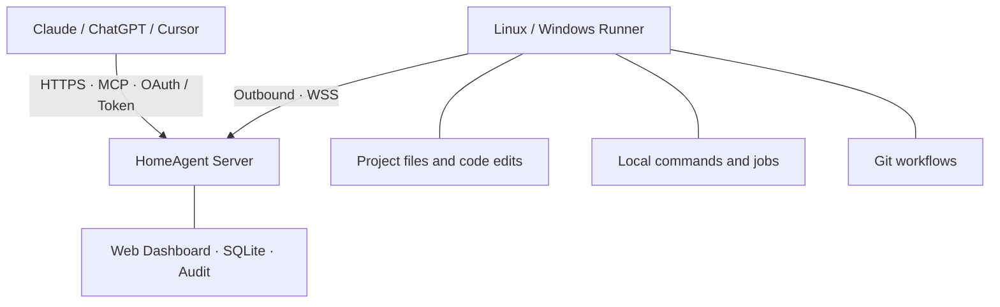

<p align="center">
  
</p>

<h1 align="center">HomeAgent</h1>

<p align="center">
  <strong>Connect AI to your development machines.</strong><br>
  Self-hosted MCP relay · Local execution · Permissions you control
</p>

<p align="center">
  <a href="https://github.com/jhxxr/HomeAgent/actions/workflows/ci.yml"></a>
  <a href="https://www.npmjs.com/package/homeagent-server"></a>
  <a href="https://www.npmjs.com/package/homeagent-runner"></a>
  <a href="LICENSE"></a>
  <a href="CONTRIBUTING.md"></a>
</p>

<p align="center">
  <a href="README.md">简体中文</a> · English
</p>

<p align="center">
  <a href="#quick-start">Quick start</a> ·
  <a href="docs/DEPLOYMENT.md">Deployment</a> ·
  <a href="docs/CLIENTS.md">AI clients</a> ·
  <a href="docs/README.md">Documentation</a> ·
  <a href="CHANGELOG.md">Changelog</a>
</p>

---

HomeAgent lets Claude, ChatGPT, Cursor and other MCP clients work on your own Linux / Windows development machines through a relay you host. Runners connect outbound and execute authorized file, command and Git operations locally, without opening inbound ports.

The execution system requires no model API key, hosted relay, telemetry or paid cloud service. Tool results are sent to the AI client you choose. Version **v0.4.8** supports one administrator and multiple devices.

## Why HomeAgent

| Your machines, your control | Built for everyday development |
| --- | --- |
| **Self-hosted relay**: keep the Server, SQLite and audit records on your server or local network. | **Files and code**: 35 tools for project context, line-based batch reads, search, strict diffs and journaled multi-file edits. |
| **Outbound runners**: authenticated WebSocket connections from Linux / Windows machines. | **Observable jobs**: immediate results for short commands; wait, read output, stop and retain records for longer tasks. |
| **Project-level access**: manage device and client permissions, with temporary elevation and automatic expiry. | **Git workflows**: review diffs, commit selected files safely, and separately control fetch / pull / push. |

## Screenshots

The overview maps **clients → MCP Server → Runners** and brings together jobs, permission reminders, audit activity and recent events. Device search, status filters, action confirmations, project permissions and job output remain available in their management views. The current interface is in Chinese.


Screenshots are rendered by a real browser using demo devices and projects in an isolated local environment, not production data. Statistics describe the audit sample returned by the Server.

<details>
<summary><strong>View the mobile layout</strong></summary>

On phones, a compact live topology keeps clients, the central MCP Server and Runners on the same screen, including the activity ring and call paths. Tap a node for its full settings; the segmented navigation opens the remaining management views.


</details>

<details>
<summary><strong>Explore device permissions and task output</strong></summary>

**Device permissions** · Configure project paths, access levels, Git permissions and grant duration in the browser.


**Jobs and output** · Filter jobs by status, inspect execution records and read command output.


</details>

## How it works



Built on the official MCP SDK v2 with Streamable HTTP `/mcp`, 2026-07-28 discovery/envelopes and legacy 2025 compatibility. Authentication includes OAuth authorization-code flow with S256 PKCE, scoped Bearer tokens and one-time device pairing. Deployment options include Docker Compose, Caddy/Nginx, optional Cloudflare Tunnel and native runner service installers.

This is an early self-hosted release, not a claim of feature parity with WebCodex or an independently audited operating-system sandbox. Persistent shells/PTY, detached tasks surviving runner replacement, automatic worktree registration, preview tunnels and a full workflow-session system are not implemented.

## Quick start

The Server and Runner are separate npm packages. Install them on the relay server
and the development machines you want to control:

| Component | npm package | Command |
| --- | --- | --- |
| Server / Web Dashboard | `homeagent-server` | `homeagent-server` |
| Runner | `homeagent-runner` | `homeagent` |

| Environment | Deployment |
| --- | --- |
| Linux server for continuous use | Docker Compose, your own domain and Caddy HTTPS |
| Existing Node.js installation or local evaluation | npm and `homeagent-server` |
| Existing Nginx / Caddy | Keep the Server on loopback and use your reverse proxy |

Follow this order: **start the Server → open the Dashboard → pair a Runner →
connect your AI client to `/mcp`**. The Server uses built-in SQLite and does not
need a separate database service.

### 1. Deploy the Server

**Option A: Docker Compose with Caddy for a public Linux server.**

Install Docker Engine, Compose v2 and Git. Point your domain at the server and
allow inbound TCP ports 80/443. Replace `mcp.example.com` below with your domain.

```sh
git clone --branch v0.4.8 --depth 1 https://github.com/jhxxr/HomeAgent.git
cd HomeAgent

# Generate random secrets without installing Node.js on the host.
docker run --rm --user "$(id -u):$(id -g)" \
  -v "$PWD:/work" -w /work \
  node:24.22.1-bookworm-slim node scripts/init.mjs
```

Edit the generated `.env`. Keep its random `ADMIN_PASSWORD` and `SESSION_SECRET`;
change or add:

```dotenv
PUBLIC_URL=https://mcp.example.com
DOMAIN=mcp.example.com
TRUST_PROXY_HOPS=1
```

```sh
docker compose --profile proxy up -d --build
docker compose --profile proxy ps
docker compose logs --tail=100 server
curl --fail https://mcp.example.com/health
```

Caddy obtains the certificate and proxies HTTP/WebSocket connections. Open
`https://mcp.example.com` and sign in with `ADMIN_PASSWORD` from `.env`. Port
`3210` is bound only to the host's loopback interface; it does not need public
access. Images build locally from source.

SQLite persists in the `server-data` named volume, and Compose configures
`restart: unless-stopped`. Back up the database and `.env` before upgrades,
retain `SESSION_SECRET`, and use ordinary restarts without deleting volumes.
See [deployment](docs/DEPLOYMENT.md) for backups, restore and an existing Nginx.

**Option B: npm on Linux / Windows or an existing Node.js server.**

Use Node.js 24 (minimum 24.14.0; `.nvmrc` contains the checked patch version)
and npm. These commands work in a Linux shell or Windows PowerShell:

```sh
npm install -g homeagent-server@latest
mkdir homeagent-server
cd homeagent-server
homeagent-server init
homeagent-server
```

Open `http://localhost:3210`. The generated `.env` contains `ADMIN_PASSWORD`;
initialization does not print the password or overwrite an existing file.
The database defaults to `data/server.sqlite` in this directory.

For public access, set `PUBLIC_URL` in `.env` to your fixed HTTPS origin. Set
`TRUST_PROXY_HOPS=1` for one trusted proxy and proxy Nginx/Caddy to
`127.0.0.1:3210`. The command runs in the foreground and reads `.env` from its
**current working directory**. Use a service manager for continuous operation;
a Linux user systemd example is in [native Server deployment](docs/DEPLOYMENT.md#原生部署-server).

### 2. Install and pair a Runner

Install Node.js 24 and npm on the development machine. Git operations also need
a local Git installation. The recommended flow is the interactive login:

```sh
npm install -g homeagent-runner@latest
homeagent login
```

The terminal asks only for the Web URL and device name, creates the private
`$HOME/.homeagent/runner.json`, and prints a browser approval link valid for
10 minutes. In your signed-in browser, confirm the device name, enter its project
directory and approve it. You can also add projects later in the Dashboard.

**The Server stores project directories and permissions.** New local Runner
configurations contain no `projects/root`. The local `stateDir` holds device
credentials and job state. Until you configure a project, no project access is
available. The first project setting is permanent by default; temporary access
remains available in the permission editor.

```sh
# Start the Runner after login:
homeagent run
```

Successful login or startup remembers the configuration location, so
`homeagent run` also works from another directory. Use `--config <path>` to select
another configuration. Lookup order: explicit path, saved location,
`~/.homeagent/runner.json`.
For first-time setup and immediate startup, use `homeagent login --run`.

Enter Windows project paths such as `E:/Projects/my-app` in the Dashboard.
Keep configuration and state outside every exposed project. Local settings accept only connection and runtime options; project policies
come exclusively from the Server.

For automatic startup, finish pairing and stop the foreground Runner, then run
`homeagent service-install`.
Linux installs a user systemd service; Windows installs a current-user login
task. The installer discovers the configuration and pins the service to that
path. This command manages the Runner only.

Command execution and Git writes are disabled by default. Enable them in the
Dashboard's device policy and grant the corresponding client scopes. Command aliases and environment profiles are configured in the Web editor.
Windows `.cmd` wrappers are not implicitly run through a shell. See the
[development workflow](docs/DEVELOPMENT_WORKFLOW.md) for executable aliases
and environment profiles.

The Dashboard manages device policies and existing PAT/OAuth grants. Device
policy controls the upper limit; client grants separately control devices,
projects, scopes, individual tools, device-wide file access and unrestricted
execution. Either layer can be temporary. Expiration stops managed jobs and
restores the permanent Server policy. Disconnecting revokes all project access
until the Server policy is synchronized again. Upgrade the Server and Runner to the same version.

### 3. Connect an AI client

| Purpose | Public deployment example |
| --- | --- |
| Dashboard | `https://mcp.example.com` |
| Client MCP endpoint | `https://mcp.example.com/mcp` |
| Runner `server` configuration | `https://mcp.example.com`, without `/mcp` |
| Health check | `https://mcp.example.com/health` |

Use OAuth and approve the device/project permissions in your browser, or issue
a client token in the Dashboard with the intended `read / write / execute / git`
scopes and connect with Bearer authentication. Tokens are shown once; device
credentials are not client tokens.

For a local trial, use `http://localhost:3210`. Remote access requires a fixed
HTTPS origin, and the Server must be hosted at the origin root rather than a
URL subpath. See [client setup](docs/CLIENTS.md) for individual clients.

### Develop from source

Use a source checkout to change the code. npm or Compose handles ordinary
installation:

```sh
git clone https://github.com/jhxxr/HomeAgent.git
cd HomeAgent
npm ci
npm run build
npm run init
npm run server
```

The source Runner commands are
`npm run runner -- login` and `npm run runner -- run`, with the same
configuration and approval flow.

## Typical development workflow

1. `list_devices` and `get_project_context`.
2. `search_files` and `read_files` for relevant code and full-file hashes.
3. `edit_files` or `apply_unified_diff` with explicit expected hashes.
4. `run_command`, then `wait_process` for long executions.
5. `git_diff`, `git_branches` and `git_commit_paths`.
6. `save_project_note` for a bounded handoff to the same client identity.

For a temporary maintenance task, open the device in the Dashboard, select the
needed project and capability preset, then edit the existing client
authorization if it also needs device-wide files or unrestricted execution.
Revoke the temporary grant early when finished; otherwise its expiry performs
the same cleanup.

Multiple online devices require an explicit `deviceId`. Machine tools also
require `projectId`. A job UUID is an identifier, not permission to access it.

## Documentation

Detailed operational documents are currently in Chinese; the examples use the
same command and configuration names on all platforms.

| Document | Purpose |
| --- | --- |
| [Documentation index](docs/README.md) | All guides |
| [Deployment](docs/DEPLOYMENT.md) | Docker, proxies, pairing, services and backups |
| [Client setup](docs/CLIENTS.md) | ChatGPT, Claude, Cursor and SDK clients |
| [Development workflow](docs/DEVELOPMENT_WORKFLOW.md) | Tools, profiles, recovery and known limits |
| [Tool reference](docs/TOOLS.md) | Arguments, scopes and admin endpoints |
| [Architecture](docs/ARCHITECTURE.md) | Protocol and persistence |
| [Security](SECURITY.md) | Trust boundaries and reporting |
| [Validation](docs/VALIDATION.md) | Tests performed and unverified environments |
| [Source audit](docs/WEBCODEX_CODE_AUDIT.md) | Explicit differences from WebCodex |

## Development

```sh
npm ci
npm run verify
npm run notices:check
npm audit --omit=dev --audit-level=high
```

Tests use temporary directories and local HTTP/WebSocket servers. Python is
optional; its workflow test reports a skip if no interpreter is available.
See [CONTRIBUTING.md](CONTRIBUTING.md) for environment details.

## Security and license

An allowed interpreter, shell or build tool runs with the runner account's
permissions. File-root checks constrain built-in file tools; they do not sandbox
arbitrary code. Use a dedicated low-privilege account or container/VM.

Original source is available under the [MIT License](LICENSE). Dependencies retain
their own terms in [third-party notices](THIRD_PARTY_NOTICES.md). The release
produces two public npm packages: `homeagent-server` contains the Server and
Dashboard, while `homeagent-runner` contains the Runner, shared protocol and Windows
helpers. Each package has an explicit file list and license notices.

See [release preparation](docs/OPEN_SOURCE.md) to generate a reviewed source
archive. Nothing in the release commands automatically publishes or pushes it.

The `v0.4.8` release configuration produces separate `homeagent-server` and
`homeagent-runner` packages; local release commands do not upload to npm or push a
GitHub Release. For subsequent releases, increment the version and update the
version files and changelog before pushing a matching `vX.Y.Z` tag. Configure
the repository's `NPM_TOKEN` Actions secret for token publishing. Prereleases use
the npm `next` tag; stable versions use `latest`. Existing npm versions must match
the verified tarball integrity to resume a failed GitHub Release. See the release
guide for required token permissions and migration to OIDC trusted publishing
with the `NPM_AUTH_MODE=oidc` repository variable.
