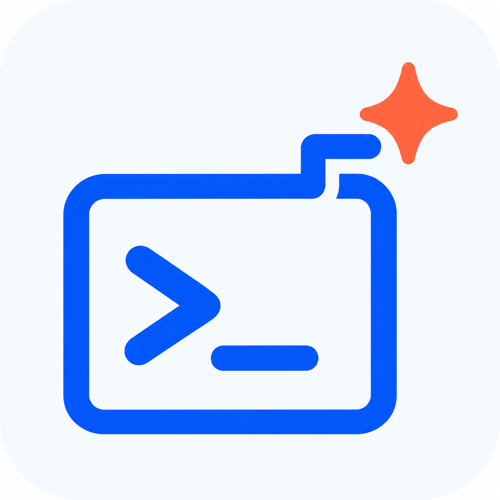
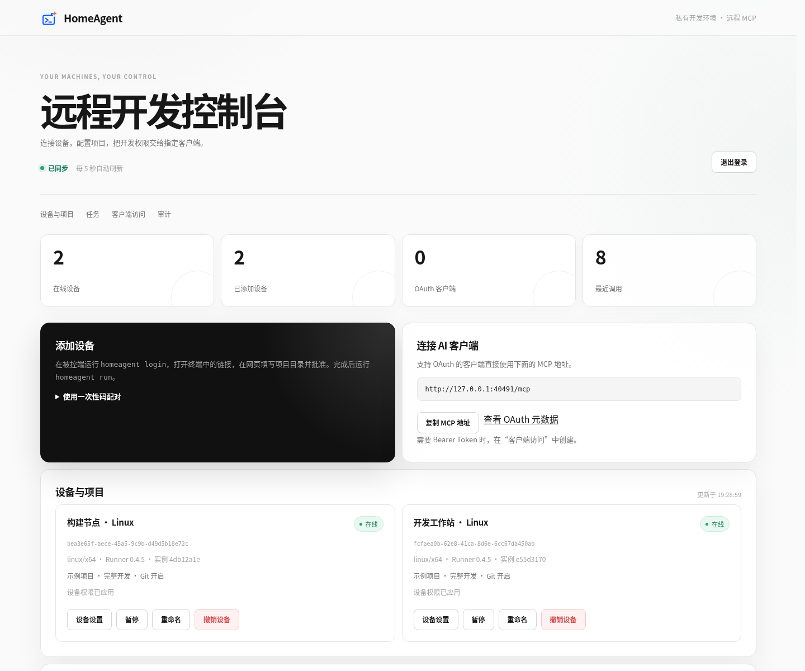
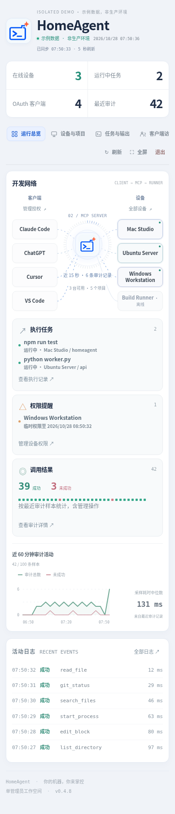
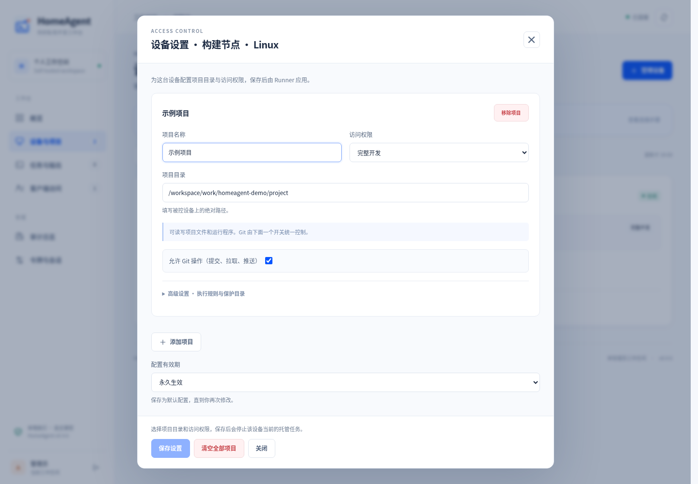
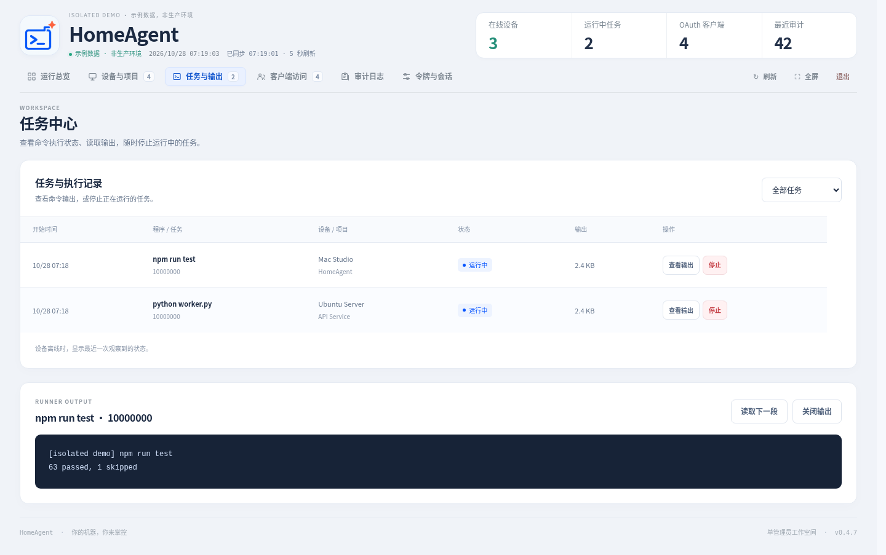
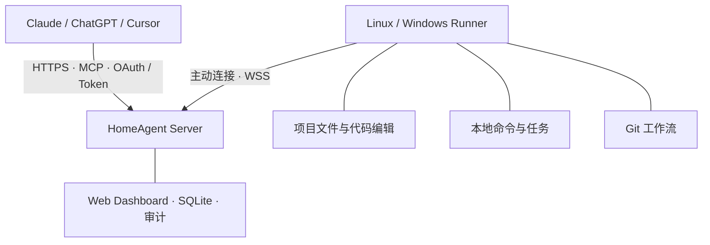
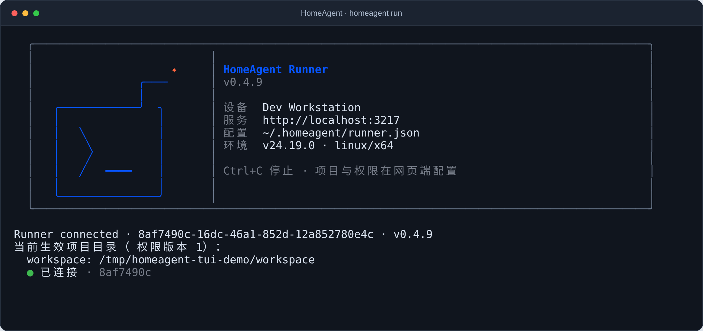

<p align="center">
  
</p>

<h1 align="center">HomeAgent</h1>

<p align="center">
  <strong>让 AI 连接你的开发机器。</strong><br>
  自托管 MCP 中继 · 本地执行 · 权限由你掌控
</p>

<p align="center">
  <a href="https://github.com/jhxxr/HomeAgent/actions/workflows/ci.yml"></a>
  <a href="https://www.npmjs.com/package/homeagent-server"></a>
  <a href="https://www.npmjs.com/package/homeagent-runner"></a>
  <a href="LICENSE"></a>
  <a href="CONTRIBUTING.md"></a>
</p>

<p align="center">
  简体中文 · <a href="README.en.md">English</a>
</p>

<p align="center">
  <a href="#快速开始">快速开始</a> ·
  <a href="docs/DEPLOYMENT.md">部署指南</a> ·
  <a href="docs/CLIENTS.md">连接 AI 客户端</a> ·
  <a href="docs/README.md">完整文档</a> ·
  <a href="CHANGELOG.md">更新日志</a>
</p>

---

HomeAgent 让 Claude、ChatGPT、Cursor 等 MCP 客户端，通过你部署的 Server 操作自己的 Linux / Windows 开发机器。Runner 主动连出，在本地执行授权的文件、命令和 Git 操作，无需开放被控端入站端口。

系统运行无需模型 API Key、第三方中继、遥测或付费云服务；工具结果会返回给你选择的 AI 客户端。当前版本 **v0.4.11**，支持单管理员、多设备。

## 为什么使用 HomeAgent

| 自己的机器，自己的控制权 | 面向日常开发 |
| --- | --- |
| **自托管中继**：Server、SQLite 和审计记录部署在自己的服务器或局域网。 | **文件与代码编辑**：35 个工具覆盖项目上下文、批量按行读取、搜索、严格 diff 和多文件编辑。 |
| **Runner 主动连接**：通过认证的 WebSocket 通道接入，支持 Linux / Windows。 | **可观察的任务**：短命令直接返回，长任务可等待、读取输出、停止，并保留执行记录。 |
| **按项目授权**：管理设备、客户端、只读或完整开发权限，支持临时提权与到期收回。 | **完整 Git 流程**：查看差异、按文件安全提交，以及独立控制的 fetch / pull / push。 |

## 界面预览

运行总览以「客户端 → MCP Server → Runner」展示开发网络，汇总任务、权限提醒、审计活动与日志。设备搜索、状态筛选、操作确认、项目权限和任务输出仍保留在对应管理视图中。



截图由真实浏览器生成，使用本地隔离环境中的演示设备与项目，非生产数据；统计以当前返回的审计样本为准。

<details>
<summary><strong>查看手机布局</strong></summary>

手机端保留「客户端 → MCP Server → Runner」同屏动态拓扑，通过紧凑节点、环形刻度和调用连线呈现开发网络；点击节点打开完整设置，其他功能通过顶部分段导航访问。



</details>

<details>
<summary><strong>查看设备权限设置与任务输出</strong></summary>

**设备权限** · 在网页中配置项目目录、访问档位、Git 开关和授权时长。



**任务与输出** · 筛选任务状态、查看执行记录并读取命令输出。



</details>

## 工作原理



使用 MCP 官方 SDK v2，提供 Streamable HTTP `/mcp`，支持 2026-07-28 discovery/envelope 与 2025 协议兼容；认证包括 OAuth 授权码流程、S256 PKCE、限权 Bearer Token 和一次性设备配对。

## 快速开始

Server 和 Runner 已拆成两个 npm 包，分别安装在中继服务器和需要被操作的开发机器上：

| 组件 | npm 包 | 命令 |
| --- | --- | --- |
| Server / Web Dashboard | `homeagent-server` | `homeagent-server` |
| Runner | `homeagent-runner` | `homeagent` |

| 场景 | 部署方式 |
| --- | --- |
| Linux 服务器长期运行 | Docker Compose + 自有域名 + Caddy 自动 HTTPS |
| 已有 Node.js 环境，或先在本机试用 | npm 安装，运行 `homeagent-server` |
| 已有 Nginx / Caddy | Server 监听回环地址，由现有反向代理提供 HTTPS |

部署顺序：**启动 Server → 打开 Dashboard → 安装并配对 Runner → 在 AI 客户端连接 `/mcp`**。Server 使用内置 SQLite，无需额外安装数据库。

### 1. 部署 Server

**方式 A：Docker Compose + Caddy，适合 Linux 公网服务器。**

准备 Docker Engine、Compose v2 和 Git，将自己的域名解析到服务器，并放行 TCP 80/443。下面以 `mcp.example.com` 为例，执行前替换成自己的域名。

```sh
git clone --branch v0.4.11 --depth 1 https://github.com/jhxxr/HomeAgent.git
cd HomeAgent

# 用容器生成随机密码和会话密钥，无需在宿主机安装 Node.js
docker run --rm --user "$(id -u):$(id -g)" \
  -v "$PWD:/work" -w /work \
  node:24.22.1-bookworm-slim node scripts/init.mjs
```

编辑刚生成的 `.env`，保留随机生成的 `ADMIN_PASSWORD` 和 `SESSION_SECRET`，修改或添加：

```dotenv
PUBLIC_URL=https://mcp.example.com
DOMAIN=mcp.example.com
TRUST_PROXY_HOPS=1
```

```sh
docker compose --profile proxy up -d --build
docker compose --profile proxy ps
docker compose logs --tail=100 server
curl --fail https://mcp.example.com/health
```

Caddy 自动申请证书并代理 HTTP/WebSocket。打开 `https://mcp.example.com`，使用 `.env` 中的 `ADMIN_PASSWORD` 登录 Dashboard。Server 端口 `3210` 默认只映射到宿主机 `127.0.0.1`，不需要向公网开放；镜像从源码在本机构建，没有预发布镜像要求。

SQLite 保存在 `server-data` 命名卷，Compose 配置了 `restart: unless-stopped`。升级前备份数据库和 `.env`；保留 `SESSION_SECRET`，不要用 `docker compose down --volumes` 作为普通重启命令。备份、恢复和已有 Nginx 的配置见 [部署文档](docs/DEPLOYMENT.md)。

**方式 B：npm 原生运行，适合 Linux / Windows 本机试用或已有 Node.js 的服务器。**

需要 Node.js 24（最低 24.14.0，仓库固定的验证补丁版见 `.nvmrc`）和 npm。以下命令可在 Linux shell 或 Windows PowerShell 中执行：

```sh
npm install -g homeagent-server@latest
mkdir homeagent-server
cd homeagent-server
homeagent-server init
homeagent-server
```

本机访问 `http://localhost:3210`，管理员密码在当前目录 `.env` 的 `ADMIN_PASSWORD` 中；初始化命令不打印密码，也不会覆盖已有配置。数据库默认位于当前目录的 `data/server.sqlite`。

公网部署时，先将 `.env` 的 `PUBLIC_URL` 改成固定 HTTPS 域名；一层可信反向代理时设 `TRUST_PROXY_HOPS=1`，再由 Nginx/Caddy 代理到 `127.0.0.1:3210`。`homeagent-server` 在前台运行，并从**当前工作目录**读取 `.env`；长期运行需配置服务管理器。Linux systemd 示例见 [原生 Server 部署](docs/DEPLOYMENT.md#原生部署-server)。

### 2. 安装并配对 Runner

在需要被 AI 操作的开发机器上安装 Node.js 24、npm；Git 工具还需要本机 Git。推荐直接使用交互式登录：

```sh
npm install -g homeagent-runner@latest
homeagent login
```

终端只询问 Web URL 和设备名称，自动生成 `$HOME/.homeagent/runner.json`，然后显示一个 10 分钟有效的浏览器登录链接。在网页中核对设备名称、填写被控端的项目目录并批准，也可以稍后在 Dashboard 的“管理设备权限”中添加项目。

**项目目录和权限只由 Server 保存**，本地配置不接受 `projects/root`。本地 `stateDir` 仅用于保存设备凭据和任务状态，不是项目目录。未配置项目时，Runner 不开放任何项目访问。首次项目设置默认永久保存；临时开放可在权限编辑器中另外选择。

```sh
# 登录完成后，直接启动：
homeagent run
```

Runner 自动记录成功登录或启动时的配置位置，切换工作目录后仍可直接使用 `homeagent run`。可通过 `homeagent run --config <路径>` 显式切换；查找顺序是显式路径、已记录路径、`~/.homeagent/runner.json`。首次登录也可使用 `homeagent login --run` 在批准后直接启动。

交互式终端启动时会进入全屏 Runner 界面，暂时隐藏此前的命令和输出，显示应用图标、设备与 Server、最近活动和实时连接状态。窗口缩放时自动调整布局，按 `Ctrl+C` 停止后恢复原终端画面。服务、管道输出或使用 `homeagent run --plain` 时保留普通日志，方便 systemd、计划任务和脚本采集。



*v0.4.11 的启动卡片（全屏改版前）：隔离演示环境中的实际终端输出，设备与目录均为演示数据。*

Windows 的项目根目录可在网页中填为 `E:/Projects/my-app`。Runner 配置和 stateDir 都必须位于所有暴露项目之外。本地只维护连接信息、设备凭据和任务状态。

需要自启动时，完成配对并停止前台 Runner，再运行 `homeagent service-install`。Linux 安装用户 systemd 服务；Windows 安装当前用户登录时启动的计划任务。安装时自动识别配置位置，生成的服务固定使用该路径。

默认不允许执行命令或 Git 写入。需要这些能力时，在 Dashboard 的设备权限中开启，并给客户端对应 scope。命令别名、环境 profile 和 linked worktree 目录同样在网页设备权限中配置。清空项目或断线后会收回全部项目访问；Server 与 Runner 应升级到相同版本。完整示例见 [日常开发工作流](docs/DEVELOPMENT_WORKFLOW.md)。

### 3. 连接 AI 客户端

| 用途 | 公网部署示例 |
| --- | --- |
| Dashboard | `https://mcp.example.com` |
| AI 客户端 MCP 地址 | `https://mcp.example.com/mcp` |
| Runner 配置的 `server` | `https://mcp.example.com`，不要加 `/mcp` |
| 健康检查 | `https://mcp.example.com/health`，返回 `version` 与 `runnerProtocol` |

版本核对：`homeagent-server --version` 和 `homeagent --version` 会打印版本、Node 与平台；`homeagent check-config` 也会列出 Runner 版本。Dashboard 顶部、页脚和“连接与安全 → 版本信息”显示 Server 版本，以及每台 Runner 上报的版本和一致性提示。升级时 Server 与 Runner 应保持同一版本。

客户端可通过 OAuth 连接，在浏览器确认设备和项目权限；也可在 Dashboard 为已配对设备创建客户端令牌，选择 `read / write / execute / git` scope，再以 Bearer token 连接。令牌仅展示一次，设备凭据不能代替客户端令牌。

本机验证时地址换成 `http://localhost:3210`；远程必须使用固定 HTTPS origin，不支持将 Server 挂在某个 URL 子路径下。各客户端配置见 [AI 客户端连接](docs/CLIENTS.md)。

### 从源码开发

需要修改源码时再选择此方式；日常安装使用上面的 npm 包或 Compose：

```sh
git clone https://github.com/jhxxr/HomeAgent.git
cd HomeAgent
npm ci
npm run build
npm run init
npm run server
```

源码 Runner 使用 `npm run runner -- login` 和 `npm run runner -- run`，配置及配对流程相同。

## 已实现的工具

| 类别 | 工具 |
| --- | --- |
| 发现与接续 | `list_devices`, `get_project_context`, `save_project_note` |
| 文件 | `list_directory`, `read_file`, `read_files`, `write_file`, `create_directory`, `move_file`, `get_file_info`, `search_files`, `edit_block`, `edit_files`, `apply_unified_diff`, `get_edit_transactions`, `recover_edit_transaction` |
| 终端 | `start_process`, `run_command`, `wait_process`, `read_process_output`, `tail_process_output`, `write_process_input`, `list_processes`, `stop_process` |
| Git | `git_status`, `git_diff`, `git_log`, `git_add`, `git_commit`, `git_commit_paths`, `git_branches`, `git_switch_branch`, `git_fetch`, `git_pull`, `git_push` |

所有机器工具使用 `projectId`。多台有权限的设备同时在线时必须指定 `deviceId`，防止误操作另一台机器。进程使用任务 UUID，由启动它的客户端主体和项目共同拥有，不接受任意系统 PID。

Dashboard 可查看任务状态、输出和停止执行；Server 仅保存有界任务元数据，输出保留在 Runner。`start_process` 可提供稳定 `idempotencyKey`，避免不确定响应后的重试再次执行。同一 stateDir 的 Runner/配对进程互斥；Windows 用 Job Object、Linux 用进程组管理子孙进程。

v0.3 以日常开发为重点：短命令同步返回、长任务等待、环形尾部日志、本机命令别名/环境配置、按行批量读取、带恢复日志的多文件编辑与严格 Diff，以及保留用户其他暂存内容的指定文件提交。完整调用顺序、配置和边界见 [日常开发工作流](docs/DEVELOPMENT_WORKFLOW.md)。

### Web 权限管理

v0.4 的权限分为两层，最终能力取设备上限与客户端授权的交集：

- **设备权限**：在 Dashboard 为每个项目设置项目目录或设备范围文件访问、命令 allowlist 或任意程序、Git 本地写入、fetch/pull 网络访问和单独的 push 权限。
- **客户端权限**：修改已有 PAT 或 OAuth 授权的设备、项目、scope、具体工具，以及“目录外文件”和“任意程序”高级开关，不需要重新复制凭据。
- **临时开放**：设备和客户端权限都可设置分钟级有效期；到期会停止相关托管任务并恢复原权限。权限 revision 冲突会被拒绝，避免覆盖他人的更新。

任意程序仍以 Runner 运行账户的权限执行，不会自动获得管理员或 root 权限。设备权限修改会取消在途调用并停止托管任务，已经产生的文件修改不会自动回滚。旧 Runner 无法应用已保存的 Web 覆盖，升级 Server 和 Runner 到同一 `0.4.x` 后再使用。

## 文档与项目结构

- [文档索引](docs/README.md)：按使用、开发、安全与设计资料导航。
- [参考项目对比](docs/COMPARISON.md)：源码修订、架构、协议、工具、安全与取舍。
- [WebCodex 逐工具源码审计](docs/WEBCODEX_CODE_AUDIT.md)：29 个工具域、192 条声明的逐项映射，已修正缺口和仍未实现的能力；不宣称全量功能对等。
- [架构与技术选型](docs/ARCHITECTURE.md)：模块、信任边界、消息协议、持久化及并发。
- [部署与运维](docs/DEPLOYMENT.md)：Docker、Caddy、Nginx、可选 Cloudflare Tunnel、配对、自启动、备份恢复。
- [AI 客户端连接](docs/CLIENTS.md)：ChatGPT、Claude、Cursor 及 MCP SDK 调试。
- [工具与配置参考](docs/TOOLS.md)：调用格式、范围、分页、进程行为和权限。
- [安全模型](SECURITY.md)：命令执行的真实权限、默认限制与尚未提供的隔离能力。
- [验证记录](docs/VALIDATION.md)：已经执行的验证和未执行的环境验收。
- [日常开发工作流](docs/DEVELOPMENT_WORKFLOW.md)：从失败测试到安全提交、断线接续；同时列明仍未实现的交互终端与预览能力。

```text
bin/            # npm CLI entry points
src/
  shared/       # versioned wire schemas, tool contracts, scopes
  server/       # MCP, WS hub, pairing, OAuth, browser auth, SQLite, admin API
  runner/       # outbound agent, local policy, files, processes, Git, services
public/         # Dashboard JS/CSS, no CDN or external fonts
deploy/         # Caddy and Nginx examples
scripts/        # secret initialization and SQLite online backup
tests/          # security/tool tests + real SDK/WS/OAuth integration
runtime/        # Windows process-tree supervisor sources
licenses/       # locked runtime dependency license texts
.github/        # Linux/Windows/Docker checks and npm/GitHub Release publishing
```

## 验证

```sh
npm run verify
npm run notices:check
npm audit --omit=dev --audit-level=high
```

服务端和 Runner 的进程、文件策略是可信组件。目录策略保护内置文件工具；一旦授权通用运行时、shell 或构建工具，命令具有运行账户的实际权限，目录白名单不构成 OS 沙箱。生产环境请用独立低权限账户或只挂载必要目录的容器。项目包含可部署实现与自动化检查，但本地测试通过不等同于独立安全审计或所有客户端、所有平台验收完成。

## 贡献与许可证

欢迎提交可复现的问题和聚焦的改动，开发方式见 [CONTRIBUTING.md](CONTRIBUTING.md)，版本范围见 [CHANGELOG.md](CHANGELOG.md)。安全问题按 [SECURITY.md](SECURITY.md) 私下报告。

原始源码使用 [MIT License](LICENSE)。依赖保留自己的许可，见 [第三方声明](THIRD_PARTY_NOTICES.md)。本项目独立开发，不代表 WebCodex、Desktop Commander 或任何 AI 客户端厂商。

发布前执行 [开源与发布检查](docs/OPEN_SOURCE.md)。npm 发布会生成两个包：`homeagent-server` 只包含 Server/Web Dashboard，`homeagent-runner` 只包含 Runner、共享协议和 Windows 辅助程序；两者都采用明确的发布文件白名单。

`v0.4.11` 的发布配置会分别生成 `homeagent-server` 和 `homeagent-runner`；本地发布命令不会自动上传 npm 或推送 GitHub。后续发布递增版本，更新版本文件和 changelog 后推送匹配标签；预发布使用 npm `next`，正式版本使用 `latest`。Token 权限、OIDC 切换和重试行为见 [自动发布说明](docs/OPEN_SOURCE.md#github-actions-自动发布)。
