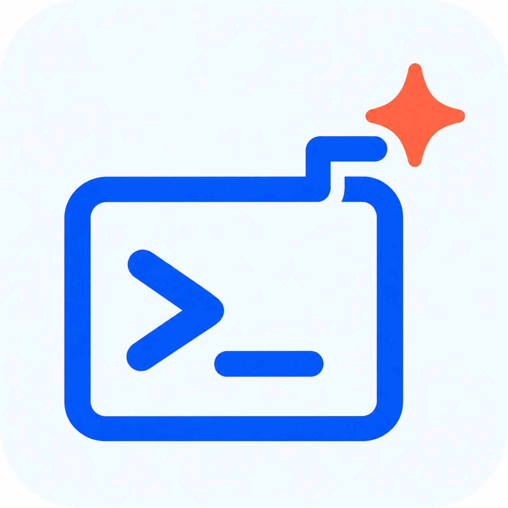
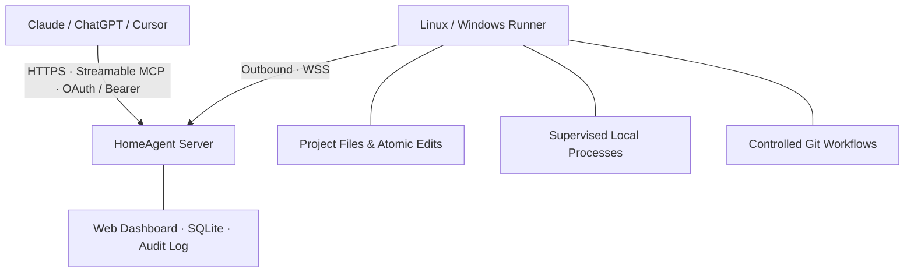
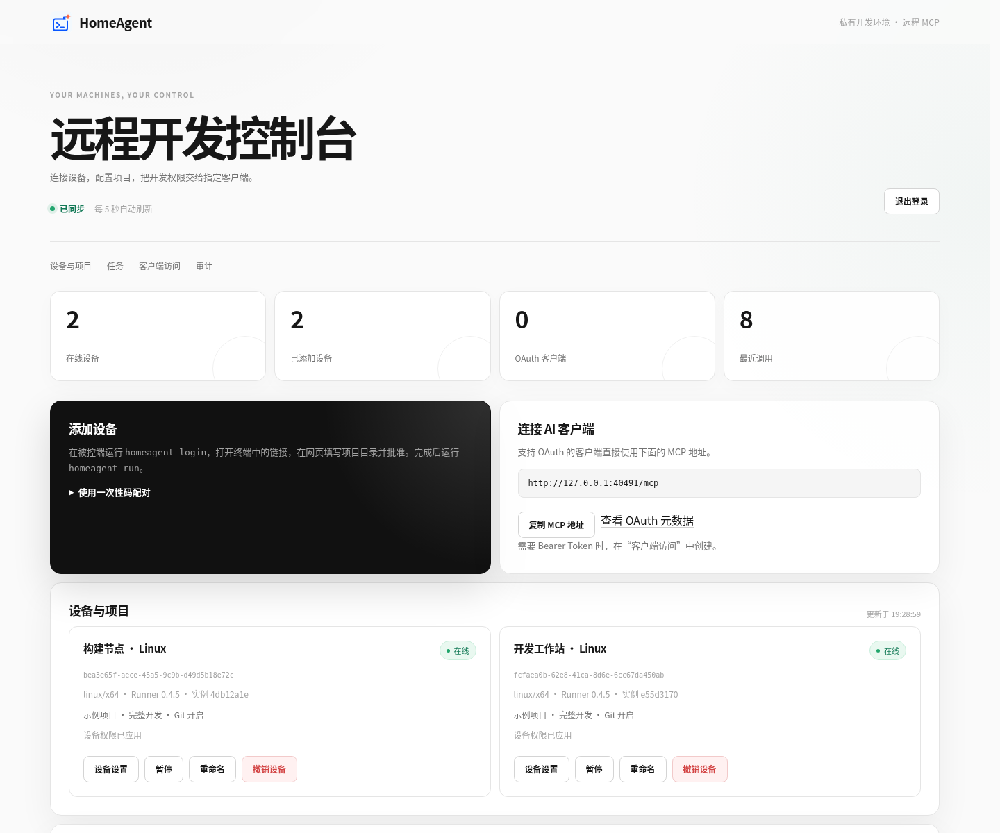
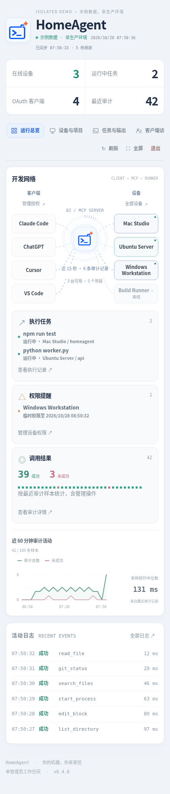
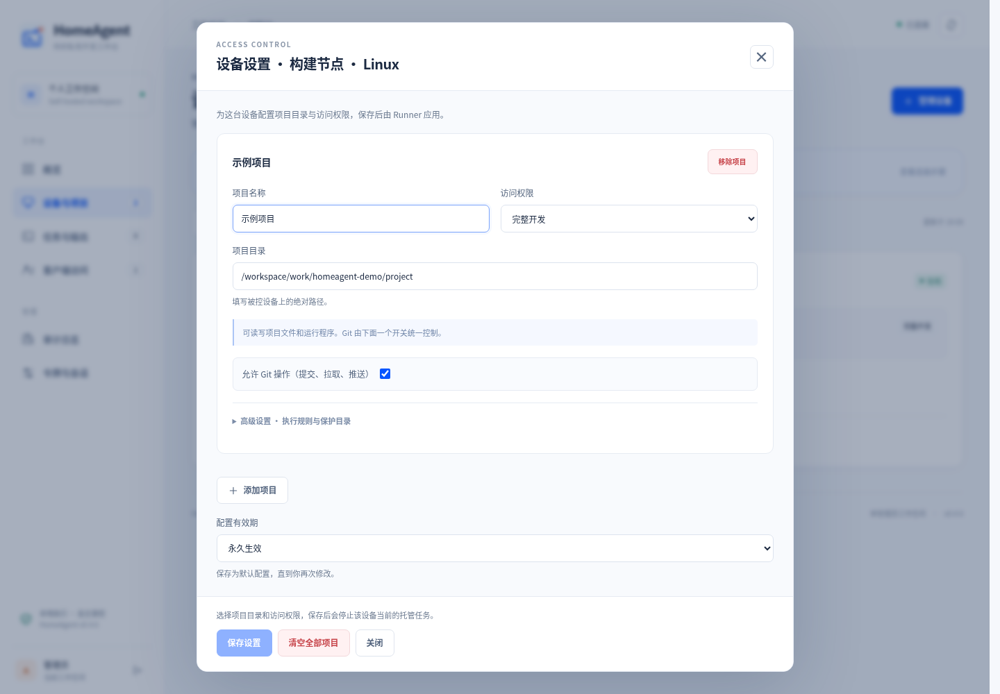
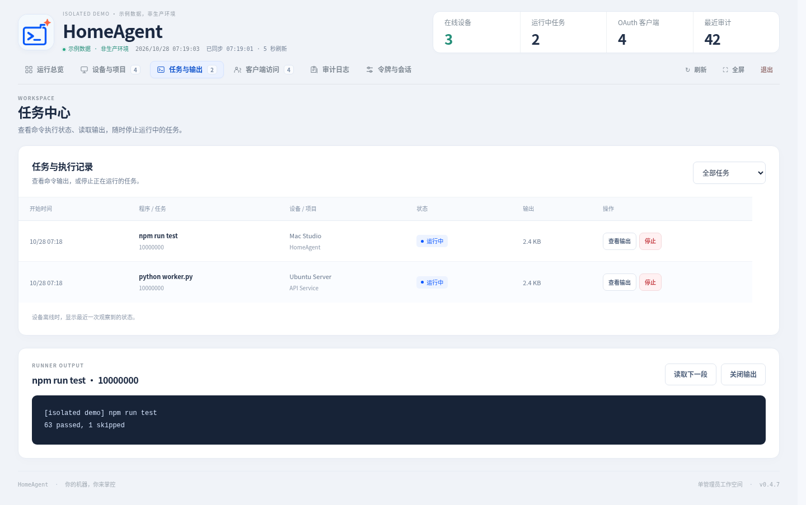
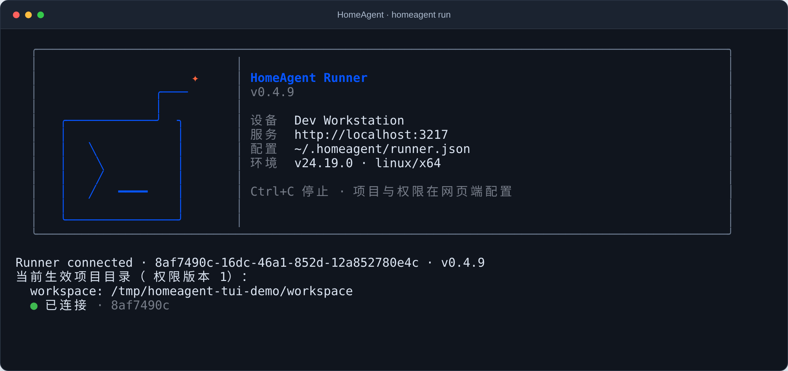

<p align="center">
  
</p>

<h1 align="center">HomeAgent</h1>

<p align="center">
  <strong>Connect AI agents to your own development machines.</strong><br>
  Self-hosted MCP relay · Outbound local execution · Fine-grained permissions
</p>

<p align="center">
  <a href="https://github.com/jhxxr/HomeAgent/actions/workflows/ci.yml"></a>
  <a href="https://www.npmjs.com/package/homeagent-server"></a>
  <a href="https://www.npmjs.com/package/homeagent-runner"></a>
  <a href="LICENSE"></a>
  <a href="CONTRIBUTING.md"></a>
</p>

<p align="center">
  <strong>English</strong> · <a href="README.zh-CN.md">简体中文</a>
</p>

<p align="center">
  <a href="#quick-start">Quick Start</a> ·
  <a href="#ai-prompting-guide">Prompt Guide</a> ·
  <a href="#remote-assist">Remote Assist</a> ·
  <a href="#mcp-tools">MCP Tools</a> ·
  <a href="docs/DEPLOYMENT.md">Deployment</a> ·
  <a href="docs/CLIENTS.md">AI Clients</a> ·
  <a href="docs/README.md">Docs</a> ·
  <a href="CHANGELOG.md">Changelog</a>
</p>

---

**HomeAgent** is a self-hosted [Model Context Protocol (MCP)](https://modelcontextprotocol.io) relay and local execution runner that lets **Claude**, **ChatGPT**, **Cursor**, and other MCP clients work directly on your Linux and Windows development machines.

Lightweight **Runners** connect outbound over authenticated WebSockets (`WSS`) to your self-hosted **HomeAgent Server**, executing authorized file, terminal, and Git operations locally without opening inbound firewall ports on your workstations. HomeAgent requires no model API keys, third-party cloud relays, or telemetry—tool outputs go straight back to the AI client you choose.

## Key Features

| Your Infrastructure, Your Control | Built for Real-World Development |
| --- | --- |
| **Self-Hosted Control Plane**: Run the Server, embedded SQLite database, and audit trail on your own VPS or local network. | **45 Built-In MCP Tools**: Project discovery, batch line-range reads, fuzzy unified diffs, journaled multi-file edits, persistent shell sessions, and LSP navigation/diagnostics. |
| **Outbound-Only Runners**: Connect Linux and Windows machines over authenticated `WSS` without port forwarding or inbound exposure. | **Observable Process Jobs**: Short commands return inline; long tasks support waiting, rolling output tails, standard input, and process-tree termination. |
| **Two-Layer Permissions**: Combine per-device capability limits with per-client OAuth / token scopes, plus temporary minute-level elevation. | **Safe Git Workflows**: Inspect status and diffs, commit explicit file paths without disturbing unrelated staged changes, and gate `fetch` / `pull` / `push` separately. |

## Architecture



- **Protocol Compatibility**: Built on the official MCP SDK v2 (`Streamable HTTP` at `/mcp`), supporting both `2026-07-28` discovery/envelopes and `2025` legacy protocol clients.
- **Authentication**: Supports Web Dashboard sign-in via admin password or [XAuth](https://github.com/jhxxr/XAuth) OIDC (binding the first XAuth account as the sole administrator), plus OAuth 2.1 authorization-code flow with `S256` PKCE, scoped Personal Access Tokens (`Bearer`), and one-time browser or pairing-code device enrollment.
- **Release Scope**: Current release **v0.4.20** supports a single administrator and multiple devices/projects. Persistent interactive PTY shells, detached jobs surviving runner replacement, automatic worktree registration, and preview tunnels are intentionally out of scope.

## Interface Preview

The Web Dashboard maps **AI Clients → MCP Server → Runners** in a live topology view and consolidates active jobs, permission alerts, and audit events.



*Screenshots are rendered in a real browser against an isolated local demo environment. The current Web Dashboard UI text is in Simplified Chinese.*

<details>
<summary><strong>View mobile topology layout</strong></summary>

On mobile screens, a compact topology keeps clients, the central MCP Server, and Runners on a single screen with live call paths and activity indicators. Tap any node to inspect or edit its settings.



</details>

<details>
<summary><strong>View device permissions &amp; job output views</strong></summary>

**Device Permissions** · Configure project directories, access presets, command allowlists, Git switches, and temporary grant durations directly in the browser.



**Jobs & Output** · Filter running or completed jobs, inspect execution metadata, and read bounded command output.



</details>

## Quick Start

HomeAgent is published as two separate npm packages:

| Component | npm Package | CLI Command | Where to Install |
| --- | --- | --- | --- |
| **Server & Web Dashboard** | `homeagent-server` | `homeagent-server` | Your VPS, homelab server, or local machine |
| **Outbound Runner** | `homeagent-runner` | `homeagent` | Each Linux or Windows development machine |

| Deployment Scenario | Recommended Approach |
| --- | --- |
| Public Linux server (24/7) | Docker Compose + custom domain + automatic Caddy HTTPS |
| Local trial or existing Node.js host | Global npm install (`homeagent-server`) |
| Existing Nginx / Caddy reverse proxy | Bind Server to `127.0.0.1:3210` behind your proxy |

Follow this sequence: **1. Deploy the Server → 2. Pair a Runner → 3. Connect an AI Client**.

### 1. Deploy the Server

#### Option A: Docker Compose with Caddy (Recommended for a Linux VPS)

Requires Docker Engine, Docker Compose v2, and Git. Point your domain's DNS record to the server and open inbound TCP ports `80` and `443`. Replace `mcp.example.com` below with your own domain:

```sh
git clone --branch v0.4.20 --depth 1 https://github.com/jhxxr/HomeAgent.git
cd HomeAgent

# Generate random ADMIN_PASSWORD and SESSION_SECRET in .env without installing Node.js on the host
docker run --rm --user "$(id -u):$(id -g)" \
  -v "$PWD:/work" -w /work \
  node:24.22.1-bookworm-slim node scripts/init.mjs
```

Edit `.env`—keep the generated `ADMIN_PASSWORD` and `SESSION_SECRET`, and set your public domain:

```dotenv
PUBLIC_URL=https://mcp.example.com
DOMAIN=mcp.example.com
TRUST_PROXY_HOPS=1
```

Build and start the stack:

```sh
docker compose --profile proxy up -d --build
docker compose --profile proxy ps
curl --fail https://mcp.example.com/health
```

Caddy automatically provisions TLS certificates and proxies HTTP and WebSocket traffic. Open `https://mcp.example.com` and sign in with `ADMIN_PASSWORD` from `.env`. Port `3210` binds only to `127.0.0.1` on the host, and SQLite data persists in the `server-data` Docker volume. See the [Deployment Guide](docs/DEPLOYMENT.md) for backups, upgrades, and custom Nginx setups.

#### Option B: Native via npm (Linux, Windows, or Local Trial)

Requires **Node.js >= 24.14.0** (see `.nvmrc` for the pinned verification version) and npm. Run in a Linux shell or Windows PowerShell:

```sh
npm install -g homeagent-server@latest
mkdir homeagent-server && cd homeagent-server
homeagent-server init
homeagent-server
```

- **Local Access**: Open `http://localhost:3210` and sign in using the `ADMIN_PASSWORD` written to `.env` in the current working directory. SQLite data is stored at `data/server.sqlite`.
- **Public Access**: Set `PUBLIC_URL=https://mcp.example.com` and `TRUST_PROXY_HOPS=1` in `.env`, then reverse-proxy traffic to `127.0.0.1:3210`. Use `systemd` or a process manager for background execution (see [Native Server Deployment](docs/DEPLOYMENT.md#native-server-deployment)).

### 2. Install & Pair a Runner

On the development machine you want to connect, install **Node.js >= 24.14.0**, npm, and `git`:

```sh
npm install -g homeagent-runner@latest
homeagent
```

1. **Interactive Login**: On first launch, the full-screen terminal interface prompts for your Server URL and a device name, creating `~/.homeagent/runner.json`.
2. **Browser Approval**: Press `o` to open the 10-minute approval link in your signed-in browser. Verify the device name, enter an initial project directory (e.g., `/home/me/app` or `E:/Projects/my-app`) and optional project name, and approve.
3. **Automatic Connection**: Once approved, the Runner connects immediately and remembers its configuration path so you can run `homeagent` from any directory.



*Terminal output from an isolated demo environment. Interactive shells open the responsive full-screen Runner TUI; services, piped output, and `homeagent run --plain` emit standard line-based logs.*

- **TUI Shortcuts & Mouse Support**: Press `s` for Settings (device name, concurrency limits, config file, Server switching, autostart, logout), `a` for Activity, `o` to open the Dashboard, `p` to pause/resume, `m` to toggle SGR mouse tracking (or set `HOMEAGENT_MOUSE=0`), and `q` or `Ctrl+C` to exit cleanly.
- **Autostart Service**: Open Settings (`s`) and select **Enable autostart** (or run `homeagent service-install` while stopped) to install a Linux user `systemd` service or a Windows login scheduled task.
- **Server-Owned Policies**: Project directories, command allowlists, environment profiles, and Git write flags are managed centrally on the Server—never hardcoded in local `runner.json`. Command execution and Git writes are disabled by default until enabled in the Dashboard.

### 3. Connect an AI Client

| Endpoint | Public Deployment Example | Notes |
| --- | --- | --- |
| **Web Dashboard** | `https://mcp.example.com` | Admin sign-in, device/client permissions, jobs, and audit logs |
| **MCP Client URL** | `https://mcp.example.com/mcp` | Streamable HTTP endpoint for Claude, ChatGPT, Cursor, etc. |
| **Runner `server` URL** | `https://mcp.example.com` | Base origin without `/mcp` |
| **Health Check** | `https://mcp.example.com/health` | Returns `version` and `runnerProtocol` |

- **OAuth 2.1**: Point your MCP client to `https://mcp.example.com/mcp` and approve the requested device, project, and scope permissions in your browser.
- **Personal Access Token (`Bearer`)**: Issue a scoped token (`read`, `write`, `execute`, `git`) in the Dashboard and configure your client with `Authorization: Bearer <token>`.
- **Version Alignment**: Keep `homeagent-server` and `homeagent-runner` on the same release (`v0.4.20`). Check versions anytime with `homeagent-server --version`, `homeagent --version`, or in the Dashboard header.
- **Client Guides**: See [Connecting AI Clients](docs/CLIENTS.md) for step-by-step instructions across Claude, ChatGPT, Cursor, and the MCP SDK.

## AI Prompting Guide

Once your AI client (ChatGPT, Claude, Cursor, etc.) is connected to `/mcp`, follow this workflow to drive remote development safely and efficiently.

### How to Instruct the AI

1. **Check Permissions First**: Before prompting, verify in the Dashboard that both the **Device Project Policy** and the **Client Grant** allow the required scopes (`read` for inspection, `write` for editing files, `execute` plus command aliases/allowlists for running tests, and `git` for commits).
2. **Start with Discovery**: Always ask the AI to call `list_devices` and `get_project_context` first. This tells the AI your exact `deviceId`, `projectId`, active Git branch/HEAD, configured command aliases (such as `test`, `npm`, `python`), and any handoff notes from previous sessions.
3. **Require Hash-Verified Edits & Safe Commits**: HomeAgent tools use full-file SHA-256 preconditions (`expectedSha256`) and explicit path commits (`git_commit_paths`) so the AI never blindly overwrites concurrent local edits or sweeps unrelated staged files into a commit.

### Ready-to-Use Prompt Templates

Copy and paste any of the templates below into your AI client, replacing the bracketed placeholders (like `[my-workstation]` or `[my-app]`) with your actual device, project, and task.

#### 1. Feature Development / Bug Fix (Full Workflow)

```text
Use the HomeAgent MCP tools to work on my remote project:
- Target device: [my-workstation] (call list_devices first to find the exact deviceId and projectId for [my-app])
- Task: [Describe the feature to build or bug to fix, e.g., "Fix the pagination off-by-one error in the user list API and add unit tests"]

Please follow this exact workflow:
1. Call list_devices and get_project_context to inspect the repository state, current Git branch/HEAD, available commandAliases, and any previous handoff notes.
2. Use search_files and read_files (with line ranges) to locate and read the relevant code. Keep the returned full-file sha256 hashes.
3. Propose your changes and apply them using edit_files or apply_unified_diff with the exact expectedSha256 values.
4. Run the test suite via run_command using the configured command alias or executable. If the job stays running, poll with wait_process (and tail_process_output if needed) rather than starting duplicate processes.
5. Show me the git_diff summary and test results. Wait for my confirmation before calling git_commit_paths, and finish by saving a brief progress summary with save_project_note.
```

#### 2. Read-Only Code Review & Troubleshooting

```text
Connect via HomeAgent MCP to project [my-app] on device [my-workstation] in read-only mode:
1. Call list_devices and get_project_context to check the project structure, recent git_log, and git_status.
2. Use search_files and read_files to trace how [specific module / endpoint / error] is implemented.
3. Do not modify any files or run any commands—summarize the root cause, point out the exact file paths and line numbers, and propose a concrete fix plan for my review.
```

#### 3. Resume Work from a Previous Session (Handoff Continuity)

```text
Connect to project [my-app] on device [my-workstation] via HomeAgent MCP:
1. Call list_devices and get_project_context, and read the saved project handoff note, current git_status, git_diff, and list_processes.
2. Summarize what was completed in the previous session, whether any background job is still running or finished, and what remains to be done.
3. Continue with the next step: [describe the next task or say "proceed with the remaining items in the project note"].
```

#### 4. Autonomous Fix-Test-Commit Loop

```text
On device [my-workstation], project [my-app], run the test suite via HomeAgent's run_command tool and fix any failing tests:
1. Call get_project_context to see the configured test command alias and current Git HEAD.
2. Run the tests with run_command (use wait_process if needed) and inspect failures with read_files.
3. Patch the code with edit_files using expectedSha256 and re-run the tests until they pass.
4. Once all tests pass, verify changes with git_diff, commit only the files you modified using git_commit_paths (preserving any unrelated staged files), and record a summary with save_project_note.
```

## Remote Assist

Need a collaborator or teammate's AI agent to help debug a machine without giving them admin credentials or permanent access?

1. **Create an Invitation**: In the Dashboard (**Devices & Projects → Invite a Friend**), generate a 10-minute one-time invitation bound to an existing client authorization.
2. **Run Locally**: The device owner runs the copied command on their machine:
   ```sh
   homeagent assist "https://mcp.example.com/assist#id=...&token=..."
   ```
3. **Explicit Local Consent**: In their local terminal, the device owner selects **1–16 project directories**, per-project read/write/executable allowlists, and a shared time limit (30m / 2h / 8h).
4. **Instant Revocation**: Access starts only after local approval and terminates immediately on local stop, exit, expiration, or disconnect. See the [Remote Assist Guide](docs/REMOTE_ASSIST.md).

## MCP Tools

### 51 Built-In Tools

| Category | Tools |
| --- | --- |
| **Discovery & Handoff** | `list_devices`, `get_project_context`, `save_project_note` |
| **Files & Code Editing** | `list_directory`, `read_file`, `read_files`, `write_file`, `create_directory`, `move_file`, `get_file_info`, `search_files`, `edit_block`, `edit_files`, `apply_unified_diff`, `get_edit_transactions`, `recover_edit_transaction` |
| **LSP & Code Intelligence** | `lsp_document_symbols`, `lsp_workspace_symbols`, `lsp_definition`, `lsp_references`, `lsp_hover`, `lsp_diagnostics` |
| **Processes & Persistent Shells** | `start_process`, `run_command`, `wait_process`, `read_process_output`, `tail_process_output`, `write_process_input`, `list_processes`, `stop_process`, `start_shell`, `run_shell`, `list_shells`, `stop_shell` |
| **Project Kanban** | `kanban_list_tasks`, `kanban_create_task`, `kanban_claim_task`, `kanban_update_task`, `kanban_submit_review`, `kanban_complete_task` |
| **Git Workflow** | `git_status`, `git_diff`, `git_log`, `git_add`, `git_commit`, `git_commit_paths`, `git_branches`, `git_switch_branch`, `git_fetch`, `git_pull`, `git_push` |

Every machine tool targets an explicit `projectId` (and requires `deviceId` whenever multiple authorized devices are online). Processes are tracked by job UUIDs owned by the initiating client principal and project—never arbitrary OS PIDs—and supervised via Linux process groups or Windows Job Objects. See [Development Workflow](docs/DEVELOPMENT_WORKFLOW.md) and [Tool Reference](docs/TOOLS.md).

### Two-Layer Web Permissions

Effective access is always the intersection of **Device Capability Limits ∩ Client Authorization**:

- **Device Policy**: Per-project root paths (or explicit device-wide file access), command allowlists (or explicit unrestricted program execution), local Git writes, `fetch`/`pull` network access, and separate `push` authorization.
- **Client Grants**: Live adjustment of authorized devices, projects, scopes (`read` / `write` / `execute` / `git`), individual tools, and advanced toggles for existing OAuth or PAT credentials—without rotating tokens.
- **Temporary Elevation**: Grant minute-level temporary permissions on either layer; expiration automatically cancels in-flight calls, stops managed jobs, and restores the baseline policy.

## Project Structure & Documentation

```text
bin/            # CLI entry points for homeagent-server and homeagent
src/
  shared/       # Versioned wire schemas, tool contracts, and permission scopes
  server/       # MCP HTTP transport, WebSocket hub, OAuth, pairing, SQLite, admin API
  runner/       # Outbound agent, local policy enforcement, file/process/Git executors, TUI
public/         # Self-contained Web Dashboard assets (zero CDN or external font dependencies)
deploy/         # Caddy and Nginx reverse-proxy templates
scripts/        # Secret initialization, SQLite online backup, and release verification
tests/          # Security, tool, TUI, and end-to-end MCP/WebSocket/OAuth test suites
runtime/        # Windows Job Object process-tree supervisor sources
licenses/       # Locked runtime dependency license notices
```

*Note: Detailed operational guides in `docs/` are available in both English (canonical, unsuffixed files) and Simplified Chinese (`.zh-CN.md` files), using identical CLI commands and configuration keys across platforms.*

| Guide | Description |
| --- | --- |
| [Documentation Index](docs/README.md) | Complete documentation overview |
| [Deployment & Operations](docs/DEPLOYMENT.md) | Docker Compose, Caddy, Nginx, Cloudflare Tunnel, pairing, autostart, and backups |
| [Connecting AI Clients](docs/CLIENTS.md) | Claude, ChatGPT, Cursor, and MCP SDK setup |
| [Development Workflow](docs/DEVELOPMENT_WORKFLOW.md) | Command profiles, batch file edits, recovery journals, and workflow boundaries |
| [Remote Assist Guide](docs/REMOTE_ASSIST.md) | One-time invitations, multi-project local consent, and security considerations |
| [Tools & Admin Reference](docs/TOOLS.md) | Tool schemas, scopes, pagination limits, and admin endpoints |
| [Architecture](docs/ARCHITECTURE.md) | Module boundaries, wire protocol, persistence, and concurrency model |
| [Security Policy](SECURITY.md) | Trust boundaries, execution model, and vulnerability reporting |
| [Validation Record](docs/VALIDATION.md) | Automated verification coverage and environment scope |
| [Project Comparison](docs/COMPARISON.md) & [Source Audit](docs/WEBCODEX_CODE_AUDIT.md) | Architectural comparison and tool-by-tool audit against reference systems |

## Development & Verification

To build and run from source:

```sh
git clone https://github.com/jhxxr/HomeAgent.git
cd HomeAgent
npm ci
npm run build
npm run init
npm run server
```

Run the full verification suite before submitting changes:

```sh
npm run verify
npm run notices:check
npm audit --omit=dev --audit-level=high
```

See [CONTRIBUTING.md](CONTRIBUTING.md) for development guidelines and [docs/OPEN_SOURCE.md](docs/OPEN_SOURCE.md) for source archive and dual-package npm release checks.

## Security & License

- **Execution Boundary**: Directory policies strictly confine built-in file tools, and Runner state/credentials are always excluded. However, **command allowlists are not an OS sandbox**—once you authorize an interpreter, shell, or build tool, it runs with the OS privileges of the Runner user account. Use a dedicated low-privilege user account, container, or VM when isolating untrusted workloads. See [SECURITY.md](SECURITY.md).
- **License**: Released under the [MIT License](LICENSE). Third-party runtime dependencies retain their respective licenses in [THIRD_PARTY_NOTICES.md](THIRD_PARTY_NOTICES.md). HomeAgent is an independent open-source project and is not affiliated with WebCodex, Desktop Commander, or any AI client vendor.
