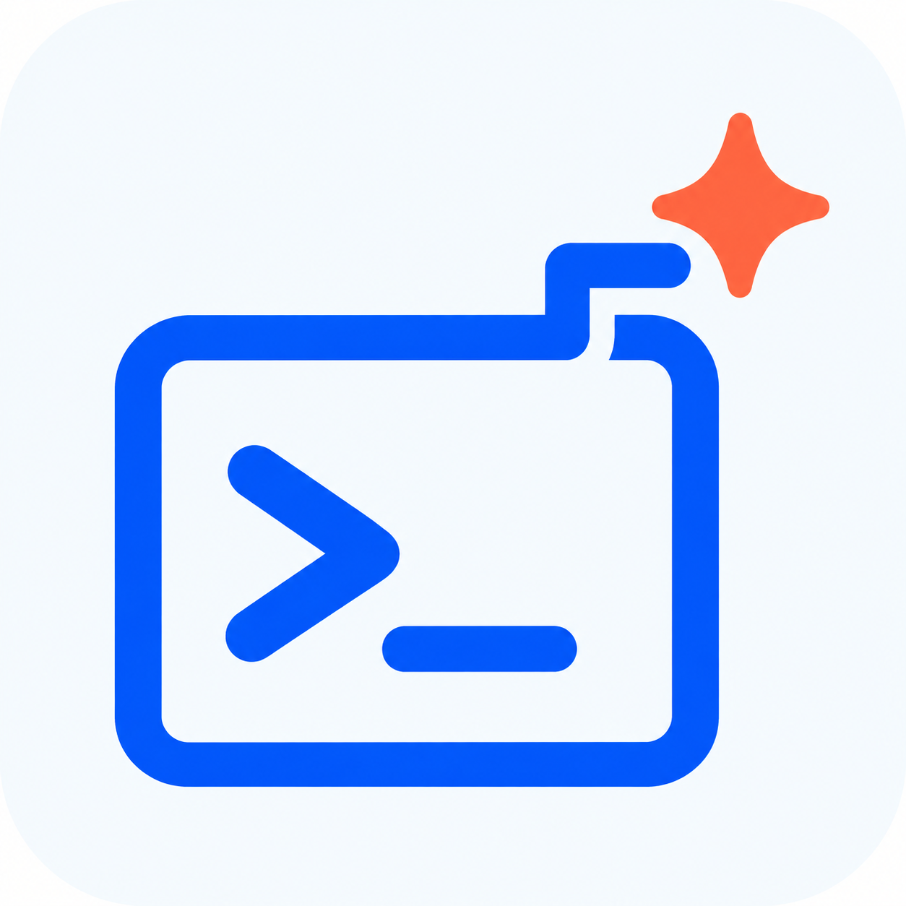
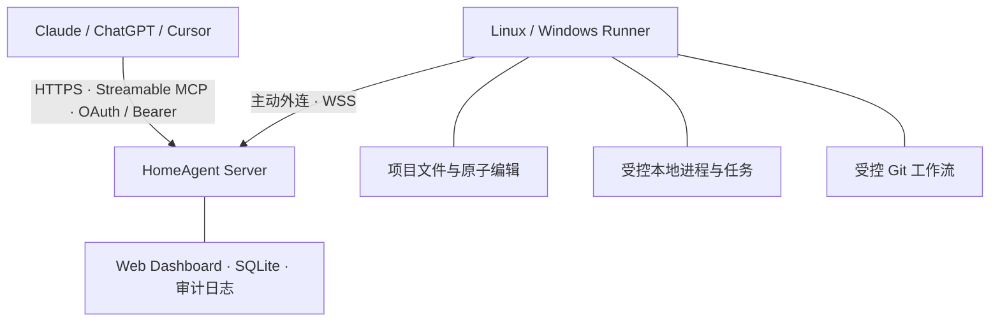
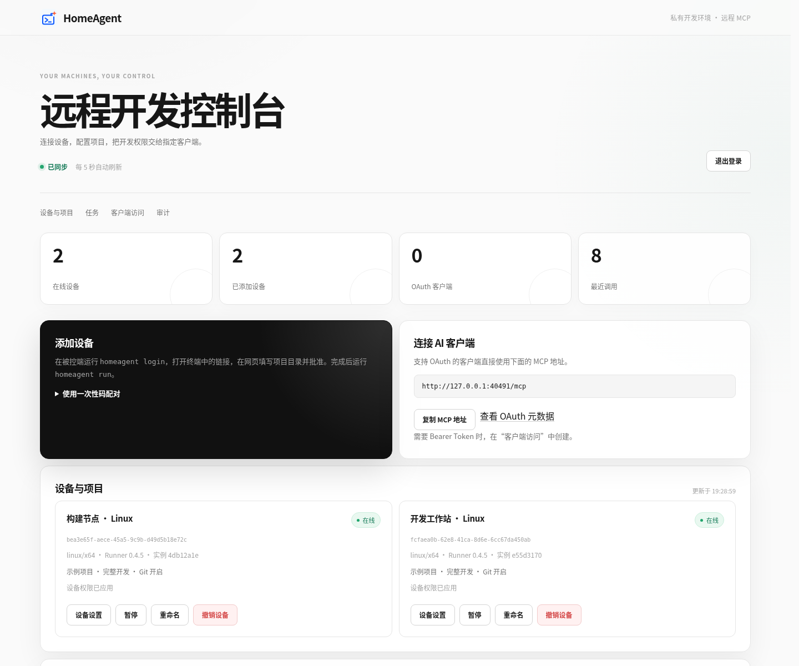
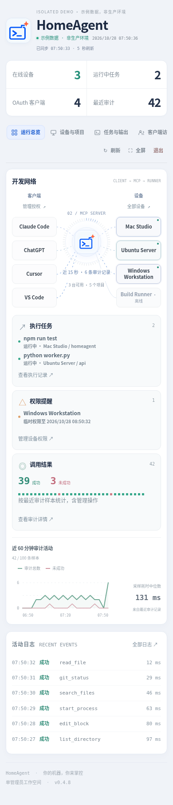
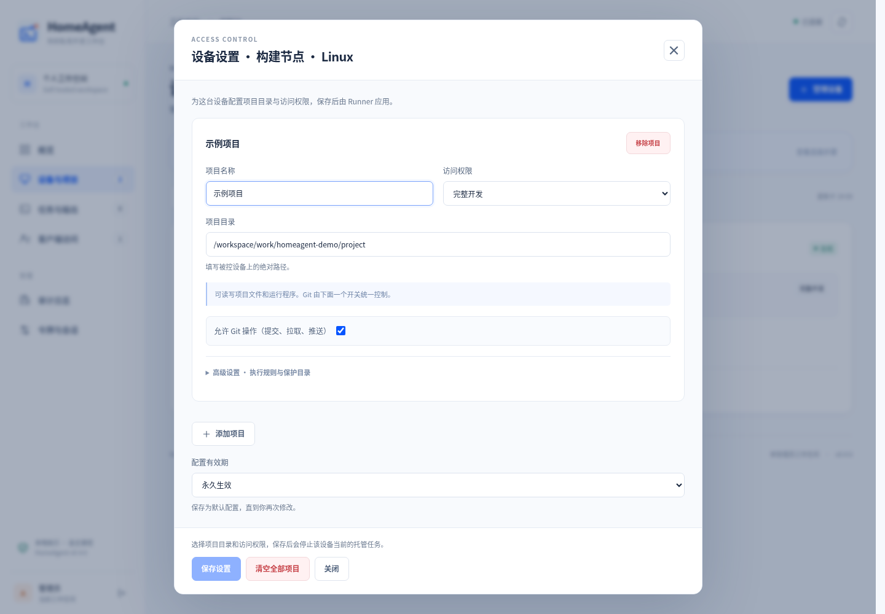
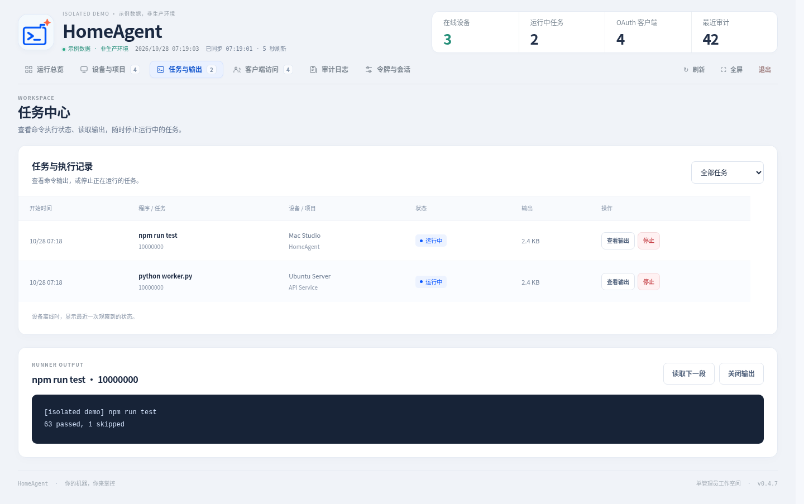
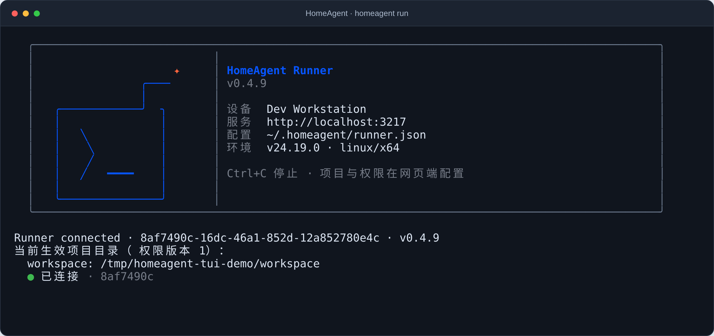

<p align="center">
  
</p>

<h1 align="center">HomeAgent</h1>

<p align="center">
  <strong>让 AI 连接你的开发机器。</strong><br>
  自托管 MCP 中继 · 本地主动执行 · 细粒度权限控制
</p>

<p align="center">
  <a href="https://github.com/jhxxr/HomeAgent/actions/workflows/ci.yml"></a>
  <a href="https://www.npmjs.com/package/homeagent-server"></a>
  <a href="https://www.npmjs.com/package/homeagent-runner"></a>
  <a href="LICENSE"></a>
  <a href="CONTRIBUTING.md"></a>
</p>

<p align="center">
  <a href="README.md">English</a> · <strong>简体中文</strong>
</p>

<p align="center">
  <a href="#快速开始">快速开始</a> ·
  <a href="#ai-远程开发教程与提示词模板">提示词教程</a> ·
  <a href="#远程协助">远程协助</a> ·
  <a href="#mcp-工具">MCP 工具</a> ·
  <a href="docs/DEPLOYMENT.zh-CN.md">部署指南</a> ·
  <a href="docs/CLIENTS.zh-CN.md">AI 客户端</a> ·
  <a href="docs/README.zh-CN.md">完整文档</a> ·
  <a href="CHANGELOG.md">更新日志</a>
</p>

---

**HomeAgent** 是一套自托管的 [Model Context Protocol (MCP)](https://modelcontextprotocol.io) 中继服务与本地执行器，让 **Claude**、**ChatGPT**、**Cursor** 等 MCP 客户端通过你掌控的 Server，直接操作自己的 Linux 与 Windows 开发机器。

被控端的 **Runner** 通过认证的 WebSocket（`WSS`）主动连出，在本地执行获准的文件读写、终端命令和 Git 操作，无需在开发机开放入站端口。系统运行无需配置模型 API Key、第三方云中继或遥测；所有工具结果直接返回给你选择的 AI 客户端。

## 核心特性

| 自己的机器，自己的控制权 | 面向真实开发工作流 |
| --- | --- |
| **自托管控制面**：Server、内嵌 SQLite 与审计日志全部部署在自己的云服务器或局域网中。 | **35 个内置 MCP 工具**：覆盖项目上下文、按行批量读取、正则搜索、严格 Diff 与带事务日志的多文件编辑。 |
| **Runner 主动外连**：Linux / Windows 开发机通过加密 `WSS` 主动连接，无需端口映射或暴露公网入站端口。 | **可观测的进程任务**：短命令同步返回；长任务支持等待、环形尾部日志、标准输入与进程树级停止。 |
| **双层权限模型**：设备能力上限与客户端 OAuth / 令牌范围取交集，支持分钟级临时提权与到期自动回收。 | **安全的 Git 流程**：查看状态与差异、仅提交指定路径而不污染其他暂存区修改，并独立控制 `fetch` / `pull` / `push`。 |

## 工作原理



- **协议兼容**：基于 MCP 官方 SDK v2 实现 Streamable HTTP（`/mcp`），同时支持 `2026-07-28` 发现与信封规范及 `2025` 协议兼容。
- **认证体系**：支持带 `S256` PKCE 的 OAuth 2.1 授权码流程、按范围受限的 Bearer 令牌（PAT），以及浏览器/配对码一次性设备绑定。
- **版本边界**：当前版本 **v0.4.18** 支持单管理员、多设备与多项目。持久交互式 PTY 终端、跨 Runner 重启保留脱离进程、自动 worktree 注册及预览隧道不在当前实现范围内。

## 界面预览

Web 控制台以 **「AI 客户端 → MCP Server → Runner」** 实时拓扑展示开发网络，集中呈现运行任务、权限提醒、审计活动与近期事件。



*截图由真实浏览器在本地隔离演示环境中生成，使用演示设备与项目，不包含生产数据。*

<details>
<summary><strong>查看手机端紧凑拓扑布局</strong></summary>

手机端同屏保留「客户端 → MCP Server → Runner」动态拓扑、活动圆环与调用连线；点击任意节点即可打开完整配置，其余视图通过顶部分段导航切换。



</details>

<details>
<summary><strong>查看设备权限设置与任务输出</strong></summary>

**设备权限** · 在浏览器中配置项目目录、访问预设、命令允许列表、Git 读写开关及授权时长。



**任务与输出** · 按状态筛选任务、查看执行元数据并读取受限命令输出。



</details>

## 快速开始

Server 与 Runner 拆分为两个独立的 npm 包，分别安装在中继服务器与需要被操作的开发机器上：

| 组件 | npm 包 | CLI 命令 | 安装位置 |
| --- | --- | --- | --- |
| **Server 与 Web 控制台** | `homeagent-server` | `homeagent-server` | 云服务器、家庭服务器或本机 |
| **Runner（被控端）** | `homeagent-runner` | `homeagent` | 需要接入的 Linux / Windows 开发机 |

| 部署场景 | 推荐方式 |
| --- | --- |
| Linux 公网服务器长期运行 | Docker Compose + 自有域名 + Caddy 自动 HTTPS |
| 本机试用或已有 Node.js 环境 | npm 全局安装并运行 `homeagent-server` |
| 已有 Nginx / Caddy 反向代理 | Server 监听 `127.0.0.1:3210`，由现有反代提供 HTTPS |

推荐按以下顺序操作：**1. 部署 Server → 2. 安装并配对 Runner → 3. 连接 AI 客户端**。

### 1. 部署 Server

#### 方式 A：Docker Compose + Caddy（适合 Linux 公网服务器）

准备 Docker Engine、Docker Compose v2 和 Git，将域名解析到服务器并放行 TCP `80` / `443` 端口。将下方示例中的 `mcp.example.com` 替换为你的域名：

```sh
git clone --branch v0.4.18 --depth 1 https://github.com/jhxxr/HomeAgent.git
cd HomeAgent

# 使用容器生成随机密码和会话密钥，无需在宿主机安装 Node.js
docker run --rm --user "$(id -u):$(id -g)" \
  -v "$PWD:/work" -w /work \
  node:24.22.1-bookworm-slim node scripts/init.mjs
```

编辑生成的 `.env`，保留随机生成的 `ADMIN_PASSWORD` 与 `SESSION_SECRET`，设置你的公网域名：

```dotenv
PUBLIC_URL=https://mcp.example.com
DOMAIN=mcp.example.com
TRUST_PROXY_HOPS=1
```

构建并启动服务：

```sh
docker compose --profile proxy up -d --build
docker compose --profile proxy ps
curl --fail https://mcp.example.com/health
```

Caddy 会自动申请 TLS 证书并代理 HTTP 与 WebSocket。浏览器打开 `https://mcp.example.com`，使用 `.env` 中的 `ADMIN_PASSWORD` 登录控制台。`3210` 端口仅绑定宿主机 `127.0.0.1`，SQLite 数据保存在 `server-data` 命名卷中。备份、升级与现有 Nginx 反代配置详见 [部署指南](docs/DEPLOYMENT.zh-CN.md)。

#### 方式 B：npm 原生运行（适合 Linux / Windows 本机试用或已有 Node.js 环境）

需要 **Node.js >= 24.14.0**（仓库验证版本见 `.nvmrc`）与 npm。在 Linux Shell 或 Windows PowerShell 中执行：

```sh
npm install -g homeagent-server@latest
mkdir homeagent-server && cd homeagent-server
homeagent-server init
homeagent-server
```

- **本机访问**：打开 `http://localhost:3210`，管理员密码位于当前目录 `.env` 的 `ADMIN_PASSWORD` 中，SQLite 默认保存在 `data/server.sqlite`。
- **公网访问**：将 `.env` 中的 `PUBLIC_URL` 改为固定 HTTPS 域名并设置 `TRUST_PROXY_HOPS=1`，再通过 Nginx / Caddy 反代至 `127.0.0.1:3210`。长期后台运行可配置 `systemd`（见 [原生部署 Server](docs/DEPLOYMENT.zh-CN.md#原生部署-server)）。

### 2. 安装并配对 Runner

在需要被 AI 操作的开发机器上安装 **Node.js >= 24.14.0**、npm（以及供 Git 工具使用的本机 `git`）：

```sh
npm install -g homeagent-runner@latest
homeagent
```

1. **交互式登录**：首次启动进入全屏欢迎页，按 `Enter` 填写 Server 地址与设备名称，自动生成 `~/.homeagent/runner.json`。
2. **浏览器批准**：等待批准界面按 `o` 打开 10 分钟有效的浏览器验证链接，核对设备名称并填写初始项目目录（如 `/home/me/app` 或 `E:/Projects/my-app`）与可选项目名称后批准。
3. **自动连接**：批准后 Runner 立即建立连接，并记住配置文件位置；此后在任意目录下运行 `homeagent` 即可直接重连。



*隔离演示环境中的终端输出。交互式终端启动响应式全屏 TUI；后台服务、管道输出或 `homeagent run --plain` 则输出标准纯文本日志。*

- **快捷键与鼠标交互**：按 `s` 打开设置（设备名称、并发上限、输出与历史记录限制、切换配置或服务地址、开机自启、退出登录），按 `a` 查看活动记录，`o` 打开控制台网页，`p` 暂停/恢复连接，`m` 切换 SGR 鼠标模式（或设置 `HOMEAGENT_MOUSE=0`），`q` 或 `Ctrl+C` 退出并恢复原终端画面。
- **开机自启**：在设置（`s`）中选择「启用自启动」（或停止前台进程后运行 `homeagent service-install`），Linux 会安装用户级 `systemd` 服务，Windows 会注册当前用户登录计划任务。
- **服务端托管权限**：项目路径、命令允许列表、环境 Profile 与 Git 写入开关统一保存在 Server 端，本地 `runner.json` 仅保存连接信息与设备凭据。命令执行与 Git 写入默认关闭，需在控制台按需开启。

### 3. 连接 AI 客户端

| 用途 | 公网部署示例 | 说明 |
| --- | --- | --- |
| **Web 控制台** | `https://mcp.example.com` | 管理员登录、设备与客户端权限、任务及审计日志 |
| **AI 客户端 MCP 地址** | `https://mcp.example.com/mcp` | 供 Claude、ChatGPT、Cursor 等连接的 Streamable HTTP 入口 |
| **Runner `server` 地址** | `https://mcp.example.com` | 填写根域名，不要加 `/mcp` |
| **健康检查** | `https://mcp.example.com/health` | 返回 `version` 与 `runnerProtocol` |

- **OAuth 2.1 连接**：在 MCP 客户端填入 `https://mcp.example.com/mcp`，在弹出的浏览器页面中勾选允许访问的设备、项目与权限范围。
- **Bearer 令牌（PAT）连接**：在控制台为已配对设备签发指定 `read / write / execute / git` 范围的客户端令牌，并以 `Authorization: Bearer <token>` 方式接入。
- **版本一致性**：升级时请保持 `homeagent-server` 与 `homeagent-runner` 版本一致（`v0.4.18`），可通过 `homeagent-server --version`、`homeagent --version` 或控制台顶部查看。
- **客户端配置详情**：各客户端完整接入步骤见 [AI 客户端连接指南](docs/CLIENTS.zh-CN.md)。

## AI 远程开发教程与提示词模板

将 AI 客户端（ChatGPT、Claude、Cursor 等）连接到 `/mcp` 后，你可以直接在对话中向 AI 下达远程开发指令。以下教程与提示词模板可帮助 AI 按照最安全、高效的工具链路操作你的远程机器。

### 使用前准备与核心原则

1. **按需开启控制台权限**：发送指令前，先在 Web 控制台确认**设备项目权限**与**客户端授权**均已勾选所需能力（只读分析仅需 `read`；改代码需开启文件写入 `write`；跑测试或构建需开启 `execute` 并配置允许的程序或命令别名；提交代码需开启 `git`）。
2. **让 AI 先调用发现工具**：在提示词中要求 AI 第一步调用 `list_devices` 和 `get_project_context`。这能让 AI 自动获取准确的 `deviceId`、`projectId`、当前 Git 分支与 HEAD、已配置的命令别名（如 `test`、`npm`、`python`）以及上次保存的交接记录。
3. **利用哈希校验与安全提交**：HomeAgent 的编辑工具（`edit_files` / `apply_unified_diff`）要求传入 `read_files` 返回的全文 `expectedSha256`，提交工具（`git_commit_paths`）仅提交显式指定的文件并保留工作区中其他无关暂存修改，从而避免 AI 误覆盖本地改动或污染 Git 提交。

### 常用提示词模板（可直接复制）

将以下模板复制到你的 AI 客户端中，把方括号（如 `[我的开发机]`、`[my-app]`）替换为你的实际设备名、项目名和任务需求即可：

#### 1. 日常功能开发 / Bug 修复（标准全流程模板）

```text
请通过 HomeAgent MCP 工具连接我的远程机器进行开发：
- 目标设备：[我的开发机]（请先调用 list_devices 获取准确的 deviceId，以及项目 [my-app] 的 projectId）
- 开发任务：[描述具体需求或 Bug，例如：修复用户列表接口分页偏移 1 页的问题，并补充单元测试]

请严格按以下步骤执行：
1. 先调用 list_devices 和 get_project_context，了解项目目录结构、当前 Git 分支/HEAD、可用的命令别名（commandAliases）以及历史交接笔记。
2. 使用 search_files 和 read_files（按行范围）定位并阅读相关源码，记录返回的全文 sha256 哈希。
3. 使用 edit_files 或 apply_unified_diff（带上准确的 expectedSha256）完成代码修改。
4. 调用 run_command 运行项目配置的测试命令或别名验证改动；若任务耗时较长，请使用 wait_process 等待完成（必要时用 tail_process_output 查看末尾输出），不要重复启动相同进程。
5. 向我展示 git_diff 变更摘要与测试结果，等我确认后再使用 git_commit_paths 仅提交本次修改的文件，最后调用 save_project_note 记录本次交接摘要。
```

#### 2. 只读代码走查与问题排查（不修改文件）

```text
请使用 HomeAgent MCP 以只读方式检查设备 [我的开发机] 上的项目 [my-app]：
1. 调用 list_devices 和 get_project_context 查看项目信息、近期 git_log 与当前 git_status。
2. 使用 search_files 和 read_files 追踪 [填写模块名 / 接口路径 / 报错信息] 的具体实现逻辑。
3. 请勿修改任何文件或执行命令——直接向我总结问题根因、列出涉及的文件路径与行号，并给出具体的修改方案供我审阅。
```

#### 3. 跨会话断点续接（恢复上次开发进度）

```text
请通过 HomeAgent MCP 连接设备 [我的开发机] 上的项目 [my-app] 并接续上次的工作：
1. 调用 list_devices 与 get_project_context，读取上次保存的项目交接记录（project note），并结合 git_status、git_diff 和 list_processes 检查当前工作区与后台任务状态。
2. 先向我汇报：上次完成了哪些改动、是否有后台任务仍在运行或已结束、还剩哪些待办事项。
3. 随后继续执行下一步：[填写下一步需求，或写“按交接记录继续完成剩余任务”]。
```

#### 4. 自动跑测、修错与安全提交闭环

```text
请连接设备 [我的开发机] 的项目 [my-app]，使用 HomeAgent 的 run_command 工具运行测试套件并修复失败用例：
1. 先调用 get_project_context 查看当前配置的测试命令别名和 Git HEAD。
2. 调用 run_command 执行测试（长任务配合 wait_process），结合测试报错使用 read_files 阅读对应源码。
3. 使用 edit_files（传入 expectedSha256）修复问题并重新运行测试，直到全部通过。
4. 测试通过后，调用 git_diff 核对改动，使用 git_commit_paths 仅提交你修改过的文件（保留我本地其他未关联的暂存内容），并用 save_project_note 保存本次修复摘要。
```

## 远程协助

需要让朋友或协作者的 AI 客户端临时协助排查机器问题，但不想提供管理员账号或永久配对？

1. **生成一次性邀请**：在控制台「设备与项目 → 邀请朋友」中，选择已有客户端授权、允许请求的权限上限与最长时长，生成 10 分钟有效的邀请命令。
2. **本机启动协助**：设备持有人在自己的终端运行复制的命令：
   ```sh
   homeagent assist "https://mcp.example.com/assist#id=...&token=..."
   ```
3. **本机逐项审批**：设备持有人在本地 Runner 中添加 **1–16 个项目目录**，逐项目设置只读/文件写入与可执行程序白名单，并选择统一时长（30 分钟 / 2 小时 / 8 小时）。
4. **随时立即停止**：仅在本机最终批准后才开放访问；本机点击「立即停止」、退出、到期或断线都会立刻终止全部托管任务并收回访问。详见 [远程协助指南](docs/REMOTE_ASSIST.zh-CN.md)。

## MCP 工具

### 45 个已实现工具

| 类别 | 工具列表 |
| --- | --- |
| **发现与接续** | `list_devices`, `get_project_context`, `save_project_note` |
| **文件与代码编辑** | `list_directory`, `read_file`, `read_files`, `write_file`, `create_directory`, `move_file`, `get_file_info`, `search_files`, `edit_block`, `edit_files`, `apply_unified_diff`, `get_edit_transactions`, `recover_edit_transaction` |
| **LSP 与代码智能** | `lsp_document_symbols`, `lsp_workspace_symbols`, `lsp_definition`, `lsp_references`, `lsp_hover`, `lsp_diagnostics` |
| **进程与持久终端** | `start_process`, `run_command`, `wait_process`, `read_process_output`, `tail_process_output`, `write_process_input`, `list_processes`, `stop_process`, `start_shell`, `run_shell`, `list_shells`, `stop_shell` |
| **Git 工作流** | `git_status`, `git_diff`, `git_log`, `git_add`, `git_commit`, `git_commit_paths`, `git_branches`, `git_switch_branch`, `git_fetch`, `git_pull`, `git_push` |

所有机器工具均通过 `projectId` 指定项目（当多台已授权设备同时在线时还须指定 `deviceId`）。进程采用由启动客户端主体和项目共同拥有的任务 UUID（不接受任意系统 PID），并通过 Linux 进程组或 Windows Job Object 管理子孙进程。详见 [日常开发工作流](docs/DEVELOPMENT_WORKFLOW.zh-CN.md) 与 [工具参考](docs/TOOLS.zh-CN.md)。

### 双层 Web 权限管理

最终可执行能力始终取 **设备权限上限 ∩ 客户端授权范围** 的交集：

- **设备权限**：为每个项目配置根目录（或显式开启设备级文件访问）、命令允许列表（或显式开启任意程序执行）、Git 本地写入、`fetch`/`pull` 网络访问及独立的 `push` 权限。
- **客户端权限**：随时在线调整已有 OAuth 或 PAT 凭据可访问的设备、项目、Scope（`read` / `write` / `execute` / `git`）、具体工具以及高级权限开关，无需重新签发或复制凭据。
- **临时提权**：设备与客户端权限均支持分钟级有效期；到期自动取消在途调用、停止托管任务并恢复原权限配置。

## 项目结构与文档导航

```text
bin/            # homeagent-server 与 homeagent 的 CLI 入口
src/
  shared/       # 版本化通信协议、工具契约与权限范围定义
  server/       # MCP HTTP 传输、WebSocket 枢纽、OAuth、配对、SQLite 与管理 API
  runner/       # 主动外连 Agent、本地策略校验、文件/进程/Git 执行器与全屏 TUI
public/         # Web 控制台前端资源（无外部 CDN 或字体依赖）
deploy/         # Caddy 与 Nginx 反向代理配置示例
scripts/        # 密钥初始化、SQLite 在线备份与发布合规检查脚本
tests/          # 安全、工具、TUI 及端到端 MCP/WebSocket/OAuth 集成测试
runtime/        # Windows Job Object 进程树监管程序源码
licenses/       # 锁定的生产依赖许可证文本
```

| 文档 | 说明 |
| --- | --- |
| [文档索引](docs/README.zh-CN.md) | 全部使用、运维、安全与设计文档总览 |
| [部署与运维](docs/DEPLOYMENT.zh-CN.md) | Docker Compose、Caddy、Nginx、Cloudflare Tunnel、配对、自启动与备份恢复 |
| [AI 客户端连接](docs/CLIENTS.zh-CN.md) | Claude、ChatGPT、Cursor 及 MCP SDK 接入指南 |
| [日常开发工作流](docs/DEVELOPMENT_WORKFLOW.zh-CN.md) | 命令别名与环境配置、按行读取、多文件原子编辑、恢复日志与工作流边界 |
| [远程协助指南](docs/REMOTE_ASSIST.zh-CN.md) | 一次性邀请、多项目本机审批、独立到期与安全边界 |
| [工具与配置参考](docs/TOOLS.zh-CN.md) | 工具参数、Scope、分页限额与管理端 API |
| [架构与技术选型](docs/ARCHITECTURE.zh-CN.md) | 模块划分、信任边界、消息协议、持久化与并发控制 |
| [安全模型](SECURITY.md) | 命令执行的真实权限边界、默认限制与漏洞报告方式 |
| [验证记录](docs/VALIDATION.zh-CN.md) | 已执行的自动化验证与环境验收范围 |
| [参考项目对比](docs/COMPARISON.zh-CN.md) 与 [源码审计](docs/WEBCODEX_CODE_AUDIT.zh-CN.md) | 与参考项目的架构对比及 29 个工具域逐项映射 |

## 源码开发与验证

需要修改源码时可从仓库直接构建运行（日常使用推荐上方的 npm 包或 Docker Compose）：

```sh
git clone https://github.com/jhxxr/HomeAgent.git
cd HomeAgent
npm ci
npm run build
npm run init
npm run server
```

提交改动或发布前请运行完整验证套件：

```sh
npm run verify
npm run notices:check
npm audit --omit=dev --audit-level=high
```

开发规范详见 [CONTRIBUTING.md](CONTRIBUTING.md)，源码归档与双包 npm 发布检查详见 [开源与发布检查](docs/OPEN_SOURCE.zh-CN.md)。

## 安全说明与许可证

- **执行安全边界**：目录白名单策略严格约束内置文件工具，并始终保护 Runner 私有配置与凭据。但**可执行程序允许列表不构成操作系统沙箱**——一旦授权解释器、Shell 或构建工具，被执行的命令即拥有 Runner 运行账户的实际系统权限。生产或高风险环境请使用独立低权限系统账户、容器或虚拟机隔离。详见 [SECURITY.md](SECURITY.md)。
- **开源许可证**：项目源码采用 [MIT License](LICENSE) 授权，第三方运行依赖保留各自许可证（见 [THIRD_PARTY_NOTICES.md](THIRD_PARTY_NOTICES.md)）。本项目独立开发，与 WebCodex、Desktop Commander 或任何 AI 客户端厂商无关。
