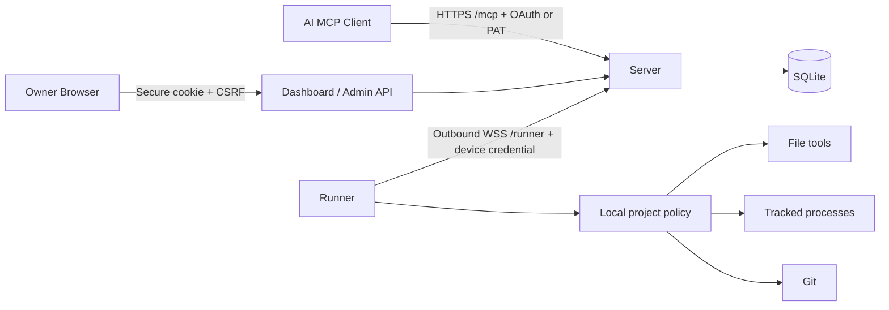

# Architecture and Technology Choices

**English** · [简体中文](ARCHITECTURE.zh-CN.md)

HomeAgent v0.4.20 builds on the v0.3 context/editor/output-log/patch foundation with a permission protocol, a Dashboard permission editor, controlled Git network tools, fuzzy unified diffs, persistent stateful shell sessions and lightweight LSP integration. The MCP catalogue now contains **51 tools** (50 Zod schemas in `src/shared/tools.ts` plus the separately defined `list_devices`). Device capability ceilings and client authorizations are stored separately; temporary grants expire and trigger job revocation. Execution semantics and persistence/recovery of the newer tools are covered in the [Development Workflow](DEVELOPMENT_WORKFLOW.md).

## Data Flow and Trust Boundaries



MCP clients cannot call the admin API; device credentials cannot access MCP; a Dashboard cookie cannot act as a Runner credential. A single administrator manages multiple devices, and external clients receive explicit device and scope grants through OAuth or PAT.

Server and Runner are both trusted code. The Runner does not trust paths, tool arguments or scopes from a request: it re-checks the Server-delivered project policy and the real filesystem boundary. The Runner cannot, however, defend against a fully compromised Server forging a principal, so the Server host and database must be protected. Content inside project directories is potentially untrusted input and must never be able to modify Runner configuration or the credential directory.

## Technology Choices

| Layer | Choice | Rationale and limits |
| --- | --- | --- |
| Runtime | Node.js 24 LTS, TypeScript strict | Shared Linux/Windows implementation, native process/file APIs, built-in SQLite; minimum 24.14, container pinned to 24.22.1 |
| MCP | `@modelcontextprotocol/server` 2.4.0, `@modelcontextprotocol/node` 2.1.2 | Official v2 `createMcpHandler`: 2026-07-28 server/discover with per-request envelopes, plus stateless 2025 initialize/tools; the v1 SDK 1.32.2 is retained only for self-hosted OAuth authorization-server helper routes and legacy-client tests |
| HTTP | Express 5 | Compatible with the SDK OAuth routes; avoids hand-rolled protocol handling |
| Runner channel | `ws`, TLS terminated by the reverse proxy | Outbound connection, request UUIDs, heartbeats, connection replacement, reconnect, frame-size limits |
| Data | `node:sqlite` WAL | No separate database service, suited to a personal single node; not designed for shared multi-replica databases |
| Dashboard | Plain HTML/CSS/JS | No frontend build chain, external CDN, fonts or runtime cloud dependency; 5-second refresh |
| Deployment | Docker Compose + optional Caddy/Nginx | Same-host, VPS and intranet reverse-proxy setups; Cloudflare is optional and introduces a third-party link |

Protocol negotiation is handled by the official v2 serving entry; tool definitions are generated into JSON Schema by Zod. The 2026 path uses server/discover and a per-request `_meta` envelope; the 2025 compatibility path uses initialize. Both create a fresh Server per request and emit no `MCP-Session-Id`. The project advertises tool capabilities only: it does not promise resources, prompts, MCP Apps, sampling or Host continuation. The Dashboard shows client authorizations, administrator login sessions and Runner jobs as distinct concepts; none of them is an upstream Workflow Session. Long-running jobs live on the Runner and do not depend on an HTTP session.

References: [MCP transport spec](https://modelcontextprotocol.io/specification/2025-11-25/basic/transports), [MCP authorization spec](https://modelcontextprotocol.io/specification/2025-11-25/basic/authorization), [TypeScript SDK](https://github.com/modelcontextprotocol/typescript-sdk), [Node.js SQLite](https://nodejs.org/api/sqlite.html).

## Modules and Execution Order

1. `server/app.ts`, `server/mcp.ts`: HTTP admin API, standard new/legacy MCP entry points, WebSocket upgrade and application lifecycle.
2. `server/hub.ts`: online devices, authenticated hello, call routing, timeout cancellation, disconnect errors and per-call auditing.
3. `runner/agent.ts`, `runner/lock.ts`: outbound connection, backoff reconnect, heartbeat monitoring, concurrency limits, OS state-directory lock and local dispatch.
4. `server/security.ts`, `oauth.ts`, pairing API: cookie/CSRF, DCR, S256 PKCE, resource binding, refresh rotation, one-time device codes.
5. `server/jobs.ts`, `public/`: persistent job observation, device status, project summaries, pairing, pause/resume/revoke, login sessions, client tokens and audits.
6. `runner/files.ts`, `processes.ts`, `shells.ts`, `lsp.ts`, `git.ts`: file, long-process, persistent-shell, LSP and Git tools; `policy.ts` performs unified validation.

## Internal Protocol

The Runner protocol version is `2` and older handshakes are rejected. One WebSocket message carries one JSON envelope, at most 2 MiB, with compression disabled. The long-lived device token is used only in the Authorization header of the TLS handshake; the device ID travels in `X-Device-ID`, never in the URL.

```json
{"type":"hello","protocol":2,"name":"workstation","platform":"win32/x64","version":"current","instanceId":"12345678-1234-4234-8234-123456789abc","capabilities":["read_file"],"projects":[]}
{"type":"welcome","protocol":2,"deviceId":"device-uuid","authorizations":[],"permissions":{"revision":3,"projects":[{"id":"app","name":"App","root":"E:/Projects/app","readOnly":false,"commands":[],"commandMode":"unrestricted","filesystemScope":"device","allowGitWrite":true,"allowGitNetwork":true,"allowGitPush":false}],"expiresAt":null,"fallbackProjects":[]}}
{"type":"permissions_applied","revision":3,"projects":[{"id":"app","name":"App","readOnly":false,"commands":[],"commandMode":"unrestricted","filesystemScope":"device","allowGitWrite":true,"allowGitNetwork":true,"allowGitPush":false}]}
{"type":"call","id":"request-uuid","tool":"read_file","args":{"projectId":"app","path":"README.md"},"principal":{"id":"pat:uuid","scopes":["read"],"devices":["device-uuid"],"projects":["app"]}}
{"type":"result","id":"request-uuid","result":{"content":[{"type":"text","text":"..."}]}}
{"type":"cancel","id":"request-uuid"}
```

Zod strictly validates tool arguments and message structure. The Server accepts a result only for a request dispatched to the current connection; another device or a replaced older connection cannot submit that request's result. The Runner allows at most 32 concurrent calls; the Server allows 32 pending calls per device and 256 in total.

Since Runner v0.2, the Runner also reports `instanceId`, tool capabilities, `job_update`, and a `jobs_snapshot` of at most 100 items per page and 10,000 items in total. The Server validates snapshot page order, immutable principal/project/admission time, monotonic revision and no regression from terminal state. Only after the snapshot completes can the Dashboard control historical jobs of that exact instance. Metadata excludes argv, raw cwd, output and error bodies. Late events from an old connection cannot overwrite a newer one.

A native WS ping is sent every 15 seconds; a missing pong disconnects. The Runner reconnects proactively after 45 seconds without a heartbeat and must send hello within 10 seconds of connecting. Reconnect uses exponential backoff capped at roughly 30 seconds with jitter. Pausing a device closes the connection and stops hosted jobs; resuming lets the Runner reconnect. Revocation stops automatic connection and requires explicit re-pairing. After a Server disconnect the Runner revokes project access and stops hosted jobs, then re-applies the Server configuration on reconnect.

### Permission Synchronization and Revocation

The Server is the single source of truth for device project settings: it stores current projects, permanent fallback projects, the applied revision and application errors. The local connection config accepts no project list or permission switches. On `welcome` or `permissions`, the Runner serially stops active calls and hosted processes, validates every root, protected path, project ID and Git setting, then replies with `permissions_applied`. If application fails, the Runner stays uncallable rather than continuing with the previous, potentially more privileged, configuration.

Every MCP dispatch re-resolves the current token family's permanent or temporary authorization from the Server and dynamically filters `tools/list`. `authorization_changed` makes the Runner stop jobs created by that authorization; temporary-grant expiry is cleaned up by a Server timer, while the Runner independently stops calls and jobs according to their expiry timestamps. `expectedRevision` prevents a stale Dashboard editor from overwriting newer permission changes.

## Remote Assist

Remote Assist reuses the Server/MCP and outbound Runner channel but uses dedicated one-time invitations and temporary devices that never enter ordinary permanent authorizations. The protocol-2 ordinary handshake is unchanged; the legacy single-project handshake is `remote-assist-v1`, while multi-project uses `remote-assist-multi-v1` with versioned inspect/claim and `assist_multi_welcome`. Activation requires the full approved project set, session/localConsentRevision, local approval and a permission-application receipt. A multi-project Runner refuses to downgrade when it meets an older Server.

The Runner holds an independent local scope and monotonic deadline fence. The effective execution scope is the intersection of the current client, the session and the per-project local approval; 1–16 projects each constrain scopes/programs, and overlapping roots or programs inside a shared root are rejected. The Server cannot replace that object or supply a permanent fallback. MCP resolves the exact target device first, then derives a project-specific family grant without writing back to the token/refresh original device snapshot; Assist never allows omitting `deviceId`. Admin output impersonation, ordinary permission edits and other families cannot bypass it. Timing starts at final approval; stopping covers all projects, first fencing admission and then bounded process cleanup, with cleanup status tracked separately from the session terminal state.

See the [Remote Assist Guide](REMOTE_ASSIST.md).

## Pairing and Authentication

A pairing code is a 40-bit random value (10 hex characters) that expires after 10 minutes. The Runner also holds a 256-bit polling credential; the administrator can only approve a code and cannot exchange it directly for a device token. Claim and state transitions use SQLite transactions and the code is consumed immediately on success. The Server stores only the SHA-256 of device tokens.

OAuth metadata, DCR, authorization codes, S256 PKCE, token and revoke routes come from the official SDK; the actual authorization state and tokens are implemented by this project. The browser confirms the client, callback URL, devices and scopes. Authorization codes are valid for 2 minutes and single-use; access tokens last 1 hour, refresh tokens 30 days with rotation on every use. Reusing a consumed refresh token revokes the whole token family. A token's `resource` is always bound to the current `/mcp`.

PATs are valid for 1–365 days, must name already-paired devices and may specify projects or device-scoped `projectGrants`. New OAuth grants must select concrete devices and projects; refresh does not widen that snapshot, and legacy v0.1 grants are not silently rewritten — revoke and re-authorize to narrow project scope. Tokens are stored as SHA-256 digests; OAuth client confidential secrets are encrypted with AES-256-GCM using a key derived from `SESSION_SECRET`. Rotating `SESSION_SECRET` invalidates old cookies and OAuth clients. Dispatch re-checks the current token, and family revocation cancels queued calls; side effects already produced and already-started independent jobs are not rolled back automatically.

## Persistence and Jobs

The Server database stores devices, pairing records, clients, authorization codes, tokens, browser sessions and audits. Audits contain only an argument digest, never argument bodies or output. Expired temporary authorization state and audits beyond the retention period are cleaned at startup and hourly.

The Server also keeps at most 10,000 job metadata rows per device, expired by the audit retention period; when the cap is reached only older terminal records are evicted. Online, terminal-retained, offline-unconfirmed and Runner-unreported are distinct observation states. Queries filter by device, project and principal before taking a bounded result; process output is never copied into the Server database.

The Runner's `jobs.sqlite` stores principal, project, start/end times, state, exit code and output counts; `<job-uuid>.output` holds merged stdout/stderr, 8 MiB by default. Once a job reaches its output cap, the pipe keeps being drained while new output is discarded and marked truncated, preventing output backpressure and unbounded disk growth. At most the configured number of historical jobs is kept; older finished records are pruned when the next job starts.

Jobs are not replayed across a Server disconnect. An HTTP 45-second timeout or disconnect can leave a result unknown; file edits and commits must be inspected before deciding to retry. Process launch supports `idempotencyKey`: for 48 hours launches are de-duplicated by principal, project and argument digest; admission is persisted first, and after a crash the interrupted/unknown result is preserved without spawning again. Replay-rejection receipts survive historical-job cleanup (up to 10,000 keys); after expiry, de-duplication is no longer guaranteed. This is not exactly-once for every tool, nor a detached supervisor.

A clean Runner exit stops and awaits hosted process trees, then closes the database and lock. Run and pairing are mutually exclusive for the same `stateDir`; the OS releases SQLite locks from a crashed process, with no PID-file guesswork. On Windows, the supervisor uses suspended admission plus a Job Object and watches for Runner death; on Linux, the original group is cleaned when the leader exits, and force-killing the Runner still needs systemd control-group or container cleanup. Unfinished records are marked interrupted at startup; no process is killed by an old PID and nothing is auto-resumed. There is no PTY, no detached job surviving a Runner restart, no workflow session, no clustering and no multi-tenancy. A full source-level comparison is in the [WebCodex Source Audit](WEBCODEX_CODE_AUDIT.md).
