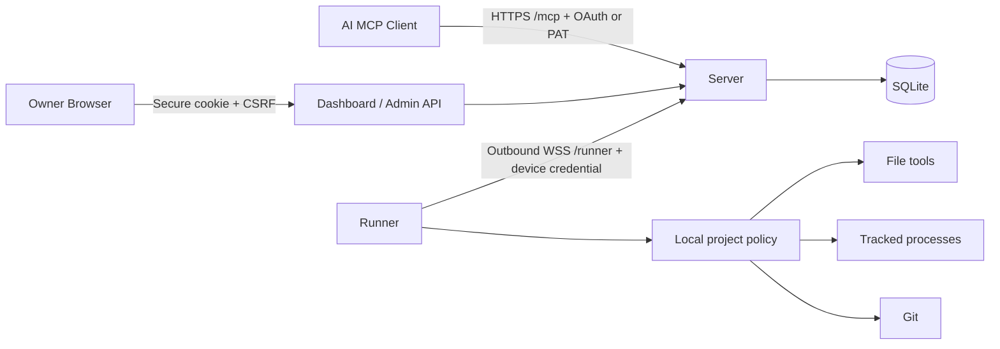

# 架构与技术选型

v0.3 增加 Runner 的 context/editor/output-log/patch 模块，MCP 目录由 19 扩展为 32 个工具，Server/Runner 主通道和认证模型保持兼容。新增工具的执行语义和持久化恢复详见 [日常开发工作流](DEVELOPMENT_WORKFLOW.md)。

## 数据流与信任边界



MCP 客户端不能调用管理 API；设备凭据不能访问 MCP；Dashboard cookie 不能作为 Runner 凭据。单管理员管理多个设备，外部客户端通过 OAuth 或 PAT 获得明确设备和权限范围。

Server 和 Runner 都是可信代码。Runner 不信任请求中的路径、工具参数和权限范围，必须再次检查本机配置；但 Runner 不能抵御被完全攻陷的 Server 伪造主体，因此必须保护 Server 主机和数据库。项目目录中的内容是潜在不可信输入，不能允许它修改 Runner 配置或凭据目录。

## 选型

| 层 | 选择 | 理由与限制 |
| --- | --- | --- |
| 运行时 | Node.js 24 LTS、TypeScript strict | Linux/Windows 共用实现，原生进程/文件 API，内置 SQLite；最低 24.14，容器固定 24.22.1 |
| MCP | `@modelcontextprotocol/server` 2.4.0、`@modelcontextprotocol/node` 2.1.2 | 官方 v2 `createMcpHandler`：2026-07-28 server/discover/逐请求 envelope，以及无状态 2025 initialize/tools；v1 SDK 1.32.2 仅保留自托管 OAuth 授权服务器辅助路由和旧客户端测试 |
| HTTP | Express 5 | 与 SDK OAuth 路由兼容，减少自制协议处理 |
| Runner 通道 | `ws`，TLS 由反代终止 | 主动连接、请求 UUID、心跳、连接替换、断线重连、帧大小限制 |
| 数据 | `node:sqlite` WAL | 无附加数据库服务，适合个人单节点；不支持多副本共享数据库 |
| Dashboard | 原生 HTML/CSS/JS | 无前端构建链、外部 CDN、字体或运行时云依赖；5 秒刷新 |
| 部署 | Docker Compose + 可选 Caddy/Nginx | 同机、VPS、内网反代均可；Cloudflare 是可选方案，会引入第三方链路 |

MCP 由官方 v2 serving entry 处理协议协商，工具定义由 Zod 生成 JSON Schema。2026 使用 server/discover 和每请求 `_meta` envelope；2025 兼容路径使用 initialize。两者都每请求创建独立 Server，不生成 MCP-Session-Id。本项目只广告工具能力，不承诺资源、prompts、MCP Apps、sampling 或 Host continuation。Dashboard 分别展示客户端授权、管理员登录会话和 Runner 任务；它们不等同于上游 Workflow Session。长任务保存在 Runner，不依赖 HTTP 会话。

依据：[MCP 传输规范](https://modelcontextprotocol.io/specification/2025-11-25/basic/transports)、[MCP 授权规范](https://modelcontextprotocol.io/specification/2025-11-25/basic/authorization)、[TypeScript SDK](https://github.com/modelcontextprotocol/typescript-sdk)、[Node.js SQLite](https://nodejs.org/api/sqlite.html)。

## 模块与执行顺序

1. `server/app.ts`、`server/mcp.ts`：HTTP 管理 API、标准新旧 MCP 入口、WebSocket upgrade 和应用生命周期。
2. `server/hub.ts`：在线设备、认证后的 hello、调用路由、超时取消、断线错误和每次调用审计。
3. `runner/agent.ts`、`runner/lock.ts`：主动连接、回退重连、心跳监测、并发限额、OS 状态目录锁及本机分发。
4. `server/security.ts`、`oauth.ts`、配对 API：Cookie/CSRF、DCR、S256 PKCE、资源绑定、刷新轮换、设备一次性码。
5. `server/jobs.ts`、`public/`：持久任务观察、设备状态、项目摘要、配对、暂停/恢复/撤销、登录会话、客户端令牌和审计。
6. `runner/files.ts`、`processes.ts`、`git.ts`：文件、长进程、Git 工具；`policy.ts` 统一验证。

## 内部协议

Runner 协议版本为 `1`，一个 WebSocket 消息对应一个 JSON 信封，最大 2 MiB，禁用压缩。长期设备令牌仅在 TLS 握手的 Authorization 头使用；设备 ID 位于 `X-Device-ID`，不放在 URL。

```json
{"type":"hello","protocol":1,"name":"workstation","platform":"win32/x64","version":"0.1.0","projects":[{"id":"app","name":"App","readOnly":false,"commands":[]}]}
{"type":"welcome","protocol":1,"deviceId":"device-uuid"}
{"type":"call","id":"request-uuid","tool":"read_file","args":{"projectId":"app","path":"README.md"},"principal":{"id":"pat:uuid","scopes":["read"],"devices":["device-uuid"],"projects":["app"]}}
{"type":"result","id":"request-uuid","result":{"content":[{"type":"text","text":"..."}]}}
{"type":"cancel","id":"request-uuid"}
```

Zod 严格验证工具参数与消息结构。Server 只接受发给当前连接的请求结果，其他设备或被替换的旧连接不能提交该请求的结果。Runner 最多 32 个同时调用，Server 每设备最多 32 个、总计最多 256 个待处理调用。

Runner v0.2 另外报告 instanceId、工具 capabilities、job_update，以及每页最多 100 项、总计最多 10000 项的 jobs_snapshot。Server 校验快照页序、主体/项目/准入时间不可变、revision 单调及终态不可回退。快照完成后才能从 Dashboard 控制该确切实例的历史任务。元数据不含 argv、原始 cwd、输出或错误正文。旧连接的迟到事件不会覆盖新连接。

WS 原生 ping 每 15 秒发送一次，漏回 pong 将断开；Runner 45 秒无心跳会主动重连。连接后 10 秒内必须发送 hello。重连使用指数回退，最高约 30 秒并附随机抖动。设备暂停关闭连接并停止托管任务，恢复后 Runner 可重新连接；撤销则停止自动连接，需要显式配对。Server 意外断线不终止长任务。

## 配对与认证

配对码为 40 bit 随机值（10 位十六进制），10 分钟过期。Runner 另外持有 256 bit 轮询凭据；管理员仅能批准码，不能从码直接领取设备令牌。领取操作和状态转移使用 SQLite 事务，成功后立即消费。Server 只保存设备令牌的 SHA-256。

OAuth 元数据、DCR、授权码、S256 PKCE、token、revoke 路由由官方 SDK 提供；实际授权状态和令牌由本项目实现。浏览器确认客户端、回调地址、设备和 scopes。授权码 2 分钟有效、只使用一次；Access Token 1 小时，Refresh Token 30 天且每次刷新轮换。重用已消费的 Refresh Token 会撤销整个令牌族。Token 的 resource 始终绑定当前 `/mcp`。

PAT 有效期 1–365 天，必须指定已配对设备，可指定项目或设备限定的 projectGrants。新 OAuth grant 必须选择具体设备与项目，刷新不扩大这个快照；v0.1 的旧 grant 不被静默重写，需撤销并重新授权以收紧项目范围。Token 存 SHA-256 摘要；OAuth 客户端 confidential secret 用 SESSION_SECRET 派生密钥做 AES-256-GCM 加密。更换 SESSION_SECRET 会使旧 cookie/OAuth 客户端失效。dispatch 再检查当前令牌，族撤销会取消仍在排队的调用；已产生的副作用和已启动的独立任务不自动回滚。

## 持久化与任务

Server 数据库保存设备、配对、客户端、授权码、令牌、浏览器 session 和审计。审计只有参数摘要，不存参数正文和输出。启动及每小时清理过期授权临时状态和超过保留期的审计。

Server 还保存每设备最多 10000 条 Job 元数据，按审计保留天数过期；上限时只逐出较旧终态记录。在线/终态保留/离线未确认/Runner 未报告是不同的观察状态。查询先按设备、项目和主体过滤后取有界结果，不复制进程输出到 Server 数据库。

Runner 的 `jobs.sqlite` 保存主体、项目、开始结束时间、状态、退出码和输出计数；`<job-uuid>.output` 保存合并 stdout/stderr，默认最多 8 MiB。每个任务的输出达上限后继续排空进程管道，丢弃新增输出并标记截断，避免输出阻塞与磁盘无限增长。最多保留配置数量的历史任务，下次启动任务时清理较旧已结束记录。

任务不在 Server 断线时重放。HTTP 45 秒超时或断线可能意味着结果未知；文件修改/提交仍需先检查再决定重试。进程启动可用 idempotencyKey：48 小时内按主体、项目和参数摘要去重；准入先持久化，崩溃后保留 interrupted/未知结果，不再次 spawn。历史任务清理后仍保留拒绝重放的收据，最多 10000 个 key；过期后不再保证去重。这不是所有工具 exactly-once，也不是 detached supervisor。

Runner 正常退出会停止并等待托管树，再关闭数据库和锁；同一 stateDir 的运行/配对互斥，OS 释放崩溃进程的 SQLite 锁，无 PID 锁文件回收猜测。Windows supervisor 用 suspended admission + Job Object 并监视 Runner 死亡，Linux 在 leader 退出时清理原组；Linux Runner 被强制杀死仍需 systemd control-group/容器清理。启动时未结束记录标为 interrupted，不按旧 PID 杀进程、不自动恢复。没有 PTY、跨 Runner 重启存活的 detached 任务、工作流会话、集群或多租户。完整源码差异见 WEBCODEX_CODE_AUDIT.md。
